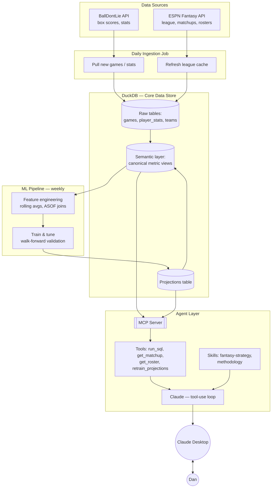

# NBA Analytics + Fantasy Strategy Agent — Design Spec

## 1. Goals

1. A system that pulls NBA data daily, stores it, and can be questioned in plain language via an agentic process.
2. A learning vehicle for how to design and deploy AI agents for analytics — with validity as a first-class concern, not an afterthought.

Four product surfaces: ad hoc stat questions ("40+ pts / 12+ reb as a road player"), career/season-view analytics, weekly fantasy strategy (draft, lineup, waivers) for an ESPN category-based head-to-head league, and open-ended data-science questions answered with a stated, checkable methodology.

---

## 2. Data Sources

### NBA data — BallDontLie API
Replaces the old CSVs and the previous stats.nba.com scraping approach entirely. Keyed, stable, no VPN rotation needed. Covers NBA data back to 1946.

| Endpoint group | Free | ALL-STAR ($9.99/mo) | GOAT ($39.99/mo) |
|---|---|---|---|
| Teams / Players | Yes | Yes | Yes |
| Games | Current season only | Full history | Full history |
| Stats / Season Averages | No | Yes | Yes |
| Advanced Stats / Box Scores / Standings / Leaders / Odds | No | No | Yes |

Rate limits (GOAT verified against the real response header during Phase 1 build): **600 req/min** — not the 6,000/min originally sourced from the docs page, which was wrong. Free (30 req/min) and ALL-STAR (600 req/min) figures still come from the docs page and haven't been independently re-verified the same way — treat as provisional until confirmed against a real header.

**Recommendation:** GOAT tier. Historical backfill isn't season-dependent, so there's no reason to wait for the season to start — the free tier is only useful for prototyping against Teams/Players. Box scores, advanced stats, and standings all require GOAT, and they're used across career-view analytics, the ad hoc query agent, and the methodology agent. ALL-STAR is a viable cheaper starting point if you want to validate the pipeline before committing to the full spend.

### Fantasy league data — ESPN Fantasy API via `espn-api` (Python)
Actively maintained (last verified push April 2026). Reads your league's actual scoring categories, roster rules, current matchup, opponent roster, standings, and free agents. Private-league auth uses two cookie values (`SWID`, `ESPN_S2`) pulled from your browser after logging in — a one-time setup. Risk: unofficial/reverse-engineered, so it's possible (not currently observed) for ESPN to break it; worth a five-minute smoke test against your real league before building on top of it.

Verified against the real league ("The Bubble 2.0", 12 teams, H2H category): `espn_api` 0.46.0 doesn't expose `settings.scoring_format` or `settings.roster_slots` — both had to be parsed from the raw `mSettings` payload using the library's own stat/position maps rather than guessed numeric IDs. Confirmed 9-cat scoring (PTS, REB, AST, STL, BLK, 3PM, FG%, FT%, TO), with TO behaviorally confirmed as inverted — a real matchup with fewer turnovers than the opponent scored as a win, not just a config flag saying so — and a 16-slot roster (10 starters, 4 bench, 2 IR).

**Landmine found here too:** before a season's draft happens, ESPN echoes the *prior* season's final roster under the new season — the roster field looks present and valid but isn't real yet. The reliable signal is `latestScoringPeriod == 0` (no games played), not `isActive` (stays true regardless) or whether roster data exists (it always does). Settings, roster rules, and the schedule are trustworthy before a draft; the roster itself isn't.

Draft settings read from the raw payload: snake format (`auctionBudget` is present but vestigial), 168 picks (12 teams x 14), 1 keeper per team with manual ordering, 90 seconds per pick, and no draft date configured in ESPN. The payload also lists a pick order that puts the user's team first, but because ESPN echoes prior-season data before a draft, that order should be confirmed in the ESPN app before anything relies on it. `league_sync.py` now captures draft settings and pick order, with verification checks.

**Landmine for live drafts:** `espn_api` exposes nothing usable for basketball drafts — `League` has no draft method, and `League.draft` is an empty list. The raw `mDraftDetail` payload is the only working source, and in it an unmade pick carries `playerId = -1`, not null. Since -1 is truthy, a truthiness test counts all 168 slots as already made. The 168 slots carry the snake order (round 2 is round 1 reversed), which suggests ESPN has generated this draft's order, though a commissioner can still change it before the draft starts.

---

## 3. Storage — DuckDB

Embedded, columnar, analytical database — no server process, single file on disk, reads/writes Parquet natively. Chosen over Postgres because the workload is almost entirely read-heavy aggregation (season rollups, career splits, "how many times has X happened"), which is exactly what a columnar engine is built for.

Two features that matter specifically for this project:
- **ASOF JOIN** — matches each row to the closest *preceding* row in another table by timestamp, natively. This is how features get built without leaking future information (e.g., "this player's rolling average *as of the day before* this game"). Most analytical databases fake this with slow self-joins; DuckDB has it as a first-class join type.
- **`vss` extension** — adds HNSW-based vector similarity search directly in DuckDB, in case the methodology agent ever needs to search over your own written notes/definitions. Means no separate vector database product is needed even if that use case comes up.

If a hosted/shareable version is ever wanted later, MotherDuck is DuckDB-as-a-service with minimal code changes.

---

## 4. Player Identity & Validation

- BallDontLie already assigns a canonical `player_id` — resolving which rows belong to the same real person is the data provider's job, not something to build. A trade mid-season should already carry one stable `player_id` across all games, with `team_id` changing per game to reflect who they were playing for.
- Because of that, this phase is validation, not construction: spot-check a few known trade/multi-team-season cases to confirm the ID actually holds up in practice before trusting it blindly.
- Cross-source ID reconciliation became real work once ESPN entered the picture: joining ESPN's player pool to BallDontLie by normalized name silently failed on real, draftable players (Nic Claxton vs. "Nicolas", Alex Sarr vs. "Alexandre", Bub Carrington vs. "Carlton", Bones Hyland vs. "Nah'Shon", KJ Martin vs. "Kenyon Jr.", and an `A.J.`/`AJ` punctuation mismatch). The fix is a persistent ESPN-to-BallDontLie player ID mapping with manual overrides for unmatched names, not re-running fuzzy name matching every time. Audited against the full players table, two more failure classes turned up: display name versus legal name (ESPN's Ace Bailey is BallDontLie's Airious Bailey) and reversed name order (ESPN's Yang Hansen is BallDontLie's Hansen Yang), which no surname heuristic can find. A surname-similarity heuristic also produced confident false positives (Morez Johnson Jr. to Magic Johnson, Cameron Boozer to his father Carlos), so every proposed match needs evidence such as games played in the right season.

---

## 5. Semantic Layer

A single canonical definition — one SQL view per derived metric (true shooting %, category value for the fantasy league, whatever else comes up) — computed once and referenced everywhere, rather than re-derived ad hoc by the agent each time it's asked. Without this, an agent that writes fresh SQL per question is a silent inconsistency risk: the same question asked two ways could produce two different answers with no way to know why. This is the mechanism by which "ensuring validity" actually gets enforced system-wide, not just talked about.

**Verified findings from real data, confirmed during Phase 1 build:**
- Stat tracking has partial onset years, not clean cutoffs — steals were ~29% populated in 1973, ~47% in 1974. `v_stat_first_tracked` exposes a first-full-season column so a query can filter itself correctly instead of assuming a hard cutoff year. Sharper finding on this one: a naive career steals leaderboard's *numbers* come out nearly correct (Stockton 3,264 vs. the real 3,265) — the defect isn't the arithmetic, it's calling it "all-time" at all, which structurally excludes players like Robertson, West, and Chamberlain not because they weren't good at it but because no one was counting yet. A correct answer needs to caveat the claim, not just get the numbers right — and this failure mode is harder to catch precisely because the output looks right.
- 206,090 rows (all pre-1950) have `NULL` rebounds — any query filtering on a rebounds threshold structurally excludes that entire era, not because those players didn't grab boards, but because it was never recorded. Same category of caveat as the steals finding above, and it applies directly to the project's own flagship query ("40+ points, 12+ rebounds as a road player").
- `plus_minus` never reaches full coverage, even in the modern era (peaked ~83% in 2020, ~63% now) — permanently partial, not "modern data is fine." `v_player_season_totals` carries a `games_with_plus_minus` count alongside the sum so a partial total is never mistaken for a complete one.
- `players.team_id` is a live snapshot of a player's *current* team, not their team at the time of a given game — confirmed mismatched on 56% of a 3,000-row sample. Historical team context must always come from the per-game `team_id` on the stats row; this field should never be used for that.
- The regular-season/playoff boundary isn't a hard reset for rolling-window stats — a player's first playoff game still carries late-regular-season games in its rolling average. Documented as intentional behavior, not a bug, unless a future use case needs otherwise.
- The `postseason` API flag is unreliable for identifying play-in games, not just Cup-final games — it reads `false` for play-in in 2022-2025, `true` in 2019 and 2021, and is split within 2020. `ist_stage` offers no help either (`NULL` on every row). Resolved with an independent classification in `semantic.sql`, built on per-team game counts rather than either flag: a Cup final is the season's sole December game on its date where both teams exceed the scheduled slate (season ≥ 2023); play-in games are each team's chronologically last games beyond the scheduled count, requiring both teams in the game to qualify. A `schedule_is_uniform` guard declines to classify play-in games when a season's schedule is irregular — the COVID-paused 2019-20 season saw teams stop at anywhere from 64 to 75 games, versus 2020-21's uniformly shortened 72-game season — rather than inventing false positives. `v_game_classification_audit` checks the result continuously: a uniform season must yield exactly `scheduled × teams / 2` regular games. Verified against three official 2024-25 averages spanning both exclusion cases (SGA and Giannis for Cup-final exclusion, Trae Young for play-in exclusion) — all match exactly post-fix.
- **Open decision, not yet settled:** DNPs currently count as zero in the rolling window — correct for fantasy point totals, likely wrong for reading current form. Must be settled before Phase 6 (projections) consumes these columns.
- Advanced stats (`/stats/advanced`) start at 1996 — 30 seasons, no interior gaps, zero rows before. Its `id` is a separate sequence from the box-score table's `id` (a game whose box-score row sat in the 15-million range had an advanced row `id` of 3,296,931) — `(game_id, player_id)` is the only safe join key. Percentage fields are fractions (0.108 = 10.8%), not already-scaled percentages.
- A specific mistake has now recurred twice and is worth naming so it doesn't happen a third time: measuring a coverage or rate metric against a denominator that includes DNP rows (which are all-NULL) understates every field and can look like a data problem that isn't one. Caught first on `plus_minus`, then again on advanced-stats coverage — an apparent 95.6% overall (75-78% in recent seasons) was actually 99.98% of *played* rows; the "gap" was DNP rows, which roughly tripled per season after 2022. Any future coverage or rate calculation must exclude DNPs from the denominator.
- Coverage regressions exist mid-era, not just at onset boundaries — `pf` drops to 80% in 1966 (~90% through 1970-73), and `fga`/`reb` both dip to 92-93% across 1971-73. These sit inside otherwise-good eras and would silently skew a query that assumes "modern-ish stat, should be fine."
- `inventory.md` (regenerated by `inventory.py` after every ingest, so it can't drift) is now the authoritative, exhaustive reference for per-stat era coverage — this section captures only the load-bearing findings, not a full duplicate.
- Modern-era spot checks alone are insufficient to catch every bug — a deliberately reintroduced defect passed ingestion cleanly and passed all three 2024-25 spot checks, and was only caught by dedicated checks against historical career totals (era-spanning players like Jerry West, Oscar Robertson, Kareem Abdul-Jabbar). Any future validation work needs checks that specifically probe old-era and full-career aggregates, not just recent-season data — bugs can be entirely invisible in the modern slice.

---

## 6. Agent Architecture

**Core mechanism:** Claude + a tool-use loop. Claude is given a system prompt, a set of tool definitions, and a question; it decides whether to call a tool, the tool executes, the result comes back, and Claude decides whether to call another tool or answer. Nothing more exotic than that underlies any "AI agent."

**Harness:** hand-roll a minimal loop first (~150 lines) as a learning exercise, then optionally adopt the **Claude Agent SDK** (built on the same harness that powers Claude Code) once the fundamentals are understood — it removes boilerplate around context management, tool permissions, and MCP extensibility.

**Three distinct question types, handled differently:**
- *Direct/countable* (Phase 4) — "how many times did X happen." One `run_sql` call, one number.
- *Recurring/fixed* (Phase 6) — the same walk-forward-validated model, run weekly.
- *Open-ended/exploratory* (Phase 8) — the agent has to design the analysis itself: define the question precisely, pick a comparison group, control for confounds, check whether the sample is big enough to say anything at all — before running it. This needs real statistics, not just aggregation.

**Tools exposed to the agent:**
- `run_sql(query)` — executes against the read-only snapshot only, never the live file; the workhorse for direct/countable questions. Built and verified with defense in depth: only `SELECT`/`WITH` are permitted, enforced both by a prefix check and independently by DuckDB's own read-only mode (so a bypassed prefix check still can't write); results are capped with a truncation note rather than overwhelming the model; query errors return as text so the model can self-correct instead of crashing. The schema is introspected at runtime rather than hardcoded, so the system prompt can't silently drift from the real database. The system prompt itself documents every landmine found so far, each tied to the concrete case that surfaced it — the postseason/Cup-final discrepancy, the `players.team_id` snapshot mismatch, `plus_minus` incompleteness — plus an instruction to prefer semantic views over ad hoc SQL, with the reason (two answers to one question, no way to adjudicate).
- `run_analysis(query, code)` — the workhorse for open-ended questions needing real statistics (correlation, regression, significance testing), since aggregation alone can't answer "does X correlate with Y." Built with containment tested empirically on the actual machine, not assumed: the sandbox is given no database handle at all — the parent runs `query` through the same verified read-only path as `run_sql`, materializes a DataFrame, and hands the child only a Parquet file, so the analysis code has no way to reach `nba.duckdb` regardless of what the sandbox itself enforces. Layered on top: a subprocess under a macOS seatbelt profile denying filesystem writes, socket neutralization against network access, a CPU time limit, a wall-clock kill, and a row cap on the materialized frame. Stated gaps rather than papered over: no hard memory cap is settable on this platform, the network block is process-level (defeatable via `ctypes` in principle), and filesystem reads are unrestricted — acceptable residual risk for a single-user local system, not a multi-tenant one.
- `check_coverage(stat, era)` — computed live from the database rather than loaded from `inventory.md`, so it can't drift and it answers for whatever stat a question actually touches rather than only what's been written up by hand. Its use is visible in the transcript, which is what makes "did the agent actually check" a verifiable question rather than a hopeful one.

**The methodology-enforcement wording is load-bearing, confirmed by a controlled comparison, not assumed.** A weak prompt ("it's good practice to explain your methodology") produced zero characters of stated reasoning before calling `run_analysis` — the agent computed first and described its approach afterward. The directive version (`MUST`, in this order, four named parts — sample / comparison / confounds / not handled — plus the stated reason: computing first means choosing the framing that fits the answer already seen) produced 1,300-1,900 characters of real methodology before every statistical call, across two separate runs. The important part: the weak version's *final answers* were still good. The failure it exists to catch is invisible from the output alone — only checking what came first, not what the answer said, reveals whether the reasoning was genuine or retrofitted.
- `get_matchup(week)` — current H2H matchup from cached ESPN data
- `get_roster()` / `get_free_agents()` — from cached ESPN data
- `retrain_projections()` — triggers the ML pipeline (Section 7), gated by a validation check before promoting a new model version

**Skills** (packaged, model-invoked expertise — `SKILL.md` files Claude loads autonomously when relevant):
- `fantasy-strategy` — the category-league marginal-impact methodology (Section 8)
- `methodology` — the validity checklist for open-ended research questions: commit to sample definition, comparison group, and confounds *before* running the analysis

**Front end — recommended path:** wrap the tools as a local **MCP server** and connect it to **Claude Desktop**, which already supports local MCP servers via config. This makes the "front end" an app you already have installed, and shrinks the actual build to the data layer and tool definitions — no bespoke UI required. **Update:** the primary front end is now a local web app (Section 14), because exploring data, saving analyses, and rendering charts need more than a chat window. The MCP/Desktop path stays possible later since the tools are shared, but it is no longer the plan of record.

**Interim interface, built and verified:** `agent.py` supports a REPL and a one-off `--ask` mode, using the exact same tools and system prompt as the battery — this is the actual day-to-day way to use the agent until the MCP/Desktop path is built, and it stays useful afterward as a fast debugging path (quicker to iterate against than a GUI). One constraint to carry forward when the MCP server gets built: extended-thinking blocks must be echoed back unchanged across turns when continuing a multi-turn tool-use conversation on the same model — solved here by appending the whole response content list rather than just the extracted text, and whatever wraps these tools next needs the same handling, not a fresh rediscovery of it.

**Concurrency constraint, discovered during Phase 1:** DuckDB is single-writer and holds an exclusive lock on its file while ingestion is running — an agent can't open the same file for reading at that moment. Resolution: ingestion keeps writing to the live file as before, then copies it to a separate read-only snapshot file once a run completes successfully; the MCP server queries the snapshot exclusively, never the live file. The agent's data is then always exactly as fresh as the last completed ingestion run, never caught mid-write. A naive file copy isn't safe for this — DuckDB keeps a non-empty `.wal` file beside the database during active writes, cleared only by `CHECKPOINT`, so copying just the main file can silently drop committed rows. The snapshot step uses DuckDB's native `COPY FROM DATABASE` instead, staged to a temp file and published via an atomic rename, so a concurrent reader always sees either the complete old snapshot or the complete new one — never a partial one. Publish now also writes a `.sha256` sidecar checksum of the snapshot file (0.34s for 174MB, effectively free), computed on-demand with caching for a snapshot published before this existed. This is the fingerprint saved analyses (Section 14) use to detect whether they ran against data that has since changed.

Publish gating requires two independent conditions: ingestion completing cleanly, and a permanent `tests/` suite passing. This was proven necessary, not just theoretically nice — a deliberately reintroduced bug passed ingestion cleanly and passed all three 2024-25 spot checks, and was only caught by checks against career-spanning historical totals (Jerry West, Oscar Robertson, Kareem Abdul-Jabbar). During that failure window, the published snapshot kept serving the prior verified data untouched while the live database held the corrupted numbers — readers were fully insulated. One known characteristic: the suite runs after ingestion completes, not as an early-abort, so a bad multi-hour backfill still runs to completion before the gate catches it — correct ordering (data can't be verified before it exists), just not a fast-fail.

---

## 7. ML Projection Pipeline

**Division of labor:** DuckDB builds features; Python (scikit-learn / XGBoost / LightGBM) fits and tunes the model; the LLM agent orchestrates and reasons over the output — it does not do the numerical optimization itself.

**Pipeline:**
1. Feature engineering in DuckDB — rolling averages, per-36 rates, rest days, opponent pace/defensive rating, home/road splits, built with ASOF JOIN for point-in-time correctness.
2. Train + tune in Python, evaluated by **walk-forward validation** (same discipline already used in the quant research tool — player performance is a time series, so random train/test shuffling leaks future information).
3. Projections written back into DuckDB as a normal table: player, week, stat, projected value, model version, generated timestamp.
4. Once games are played, projected-vs-actual gets compared in the same database — a running accuracy record, not just a one-time backtest.

**Building/tuning it with agent help (Claude Code):** give it a falsifiable hypothesis (not "build a good model" — something like "recent-form-weighted average + opponent pace beats a flat season average for rebounds"), the data location, and the fixed evaluation method. It writes code, runs it, reads the validation score, adjusts, and repeats — genuinely agentic model-building, bounded by a number rather than a vibe. Two hard rules: never let it tune against the same data it's judged on (hold out a real final test set), and review before anything gets promoted to production.

**Output as ranges, not points:** low-count stats (blocks, steals, threes) are high-variance — a category-league roster decision should weigh variance, not just expected value.

**Benchmark for the projection model:** the draft board's recency-weighted per-game baseline predicts next-season 9-cat total value with a Spearman of about 0.71 (top-100 hit rate about 0.73) across 1986-2025, walk-forward. Any Phase 6 model has to beat that number under the same protocol, or it isn't earning its complexity.

---

## 8. Fantasy Strategy Logic (category H2H)

For each scored category: compare your roster's recent production to your current opponent's, weighted by each side's remaining games that week (from the NBA schedule). This surfaces which categories are winnable, which are lost causes, and which a specific waiver pickup would flip — a well-defined, agent-executable calculation once projections and matchup data both exist.

**Validated finding (draft strategy):** in a walk-forward simulated draft (drafting on three prior seasons, scoring on the next season's actual production, 70 drafts), weighting picks by category balance made teams worse, and monotonically so — at the original aggressiveness the category win share fell by 0.082 against picking straight down the board, and at a near-neutral setting it reached parity (-0.017, p = 0.105). Elite players are strong in several categories at once, so passing on them for single-category specialists costs more total production than the balance recovers. The working conclusion is to draft for value and fix category needs in-season through waivers, where a roster can actually be adjusted. Caveats: opponents in the simulation were a noisy version of the same value ranking, so the absolute win shares say nothing about beating real leaguemates, and the test covers the draft only.

**Validation trap to remember:** the first version of that simulation scored the same quantity the strategies were optimizing, and it showed the user's team finishing first in 100% of runs. A result that clean is the sign of a circular test, not a strong strategy. Validate against production the strategy did not optimize.

---

## 9. System Data Flow

**How it runs:** ingestion runs daily (new games/box scores, refreshed league cache). The ML pipeline runs weekly, ahead of matchup deadlines. The agent runs on demand — a question in Claude Desktop triggers the MCP server's tools against the current state of DuckDB.

---

## 10. Build Order

1. **Pipeline + schema** — daily ingestion, historical backfill — complete: 1,685,039 rows across 73,174 games, 5,147 players, 80 seasons (1946-2025), verified intact after an unplanned power loss
2. **Player identity validation** — spot-check that BallDontLie's `player_id` already resolves correctly across trades/multi-team seasons (it should, as the data provider's job) — light verification, not a build
3. **Semantic layer** — canonical metric definitions — complete: TS%/per-36/rolling views, career and season-total views, plus the three-way game classification (Section 5)
4. **Text-to-SQL Q&A agent** — ad hoc stat questions; validates the schema end to end — complete: first live battery matched all three ground-truth-verified answers exactly (flagship road 40/12 count, career steals leaderboard, Luka's trade-split scoring) and correctly applied the era-tracking and `team_id` caveats unprompted
5. **Fantasy league integration** — `espn-api` caching of league settings, matchups, rosters, free agents — complete: verified against the real league, including a behavioral (not just config) confirmation of category scoring rules
6. **Projection pipeline** — feature engineering, walk-forward-validated model, projections stored in DuckDB
7. **Fantasy strategy agent** — category marginal-impact logic using projections + matchups
8. **Data science methodology agent** — open-ended questions, validity checklist enforced up front, backed by the `run_analysis` tool for real statistics rather than aggregation alone — complete: 5-question battery, 0 errors, every question called `check_coverage` unprompted, 9/9 independently spot-checked numbers reproduced exactly (including TS% to four decimals), and the directive methodology wording was confirmed load-bearing via controlled comparison against a weak version (Section 6)
9. **Draft prep tooling** — deadline-driven, so it jumps the queue: the 2026-27 season opens Oct 20 and the draft is expected about a week before (~Oct 13, date unconfirmed). Draft board built from advanced stats and the existing agent, scored for the league's 9-cat format: per-category contribution, turnover drag, position scarcity, and the one-keeper rule. Caution: the ESPN roster is pre-draft placeholder data until the draft happens (Section 2).
   - **Status:** first version built and verified (`draft_board.py`, 378 players, three players recomputed through an independent SQL path, raw category leaders match real-world leaders). Method: ESPN's top 400 joined to the snapshot, recency-weighted per-game rates over three seasons (0.60 / 0.30 / 0.10, scaled by games played), z-scores against a 168-player pool, FG%/FT% as volume-weighted impact, TO negated. That check confirms the arithmetic, not predictive validity — the weights are unvalidated.
   - **Hardening pass done:** the weights were backtested walk-forward over 40 target seasons (1986-2025, each predicted only from the three prior seasons, with an identical z-score pool across schemes). Recency-only scored slightly higher overall (Spearman 0.718 vs 0.713 for the shipped 0.6/0.3/0.1, p = 0.026), but the edge disappears in 2010+ (p = 0.132) and reverses for players with under 50 games the prior season (-0.028, p = 0.094 — suggestive, not conclusive). Weights left unchanged; all four schemes fall within about 0.04 Spearman, so the weighting is not where the value is. The ESPN-to-BallDontLie ID map (`espn_bdl_id_map.csv`) replaced name matching: 373 exact matches, 5 aliases, 16 unmatched, 0 ambiguous. Injury status is re-pulled at run time with its age printed, and OUT players are excluded from best-available by default. `league_sync.py` now captures draft settings with three verification checks.
   - **Draft tooling built:** the unmatched list was audited against the full players table (two real failures found and fixed, 14 genuine 2026 rookies remain and appear in an "ESPN rank only" section); `keepers.csv` removes kept players from the pool and warns on names that match nobody; `draft_assistant.py` ranks available players by marginal value with a `--live` mode and a manual `--picks` fallback. Validated walk-forward, the assistant does not beat drafting straight down the board (Section 8), so it ships as an advisory view, not an auto-picker.
   - **Still open:** keepers must be entered as they are declared; the draft date and pick order need confirming with the commissioner; live mode has never run against a real draft, so the manual fallback should be rehearsed; and no backtest exists against ESPN's own ranking, so the board's disagreements with consensus are unvalidated (its Spearman with ESPN's rank is 0.77).
10. **Analysis artifacts + report format (CLI first)** — every agent run persisted as a saved analysis object; chart-spec tool; a fuller report structure; a depth setting. Built and verified in the terminal before any UI exists (Section 14).
11. **Local backend + Ask view** — FastAPI over the snapshot, reusing the agent's tools; a React view that renders saved analyses with charts, verbatim SQL, and re-run (Section 14).
12. **Explorer** — player and team pages, leaderboards, dataset catalog, coverage shading; no LLM involved (Section 14). Complete: built, verified in-browser, PDF-printable, concurrency-safe under 30 simultaneous requests.
13. **Correlation explorer, knowledge base, investigate hand-off** — complete, and validated by a landmark test case. Deliberately chose jersey number vs. free-throw % as an adversarial test: naive r=-0.075, p=1.2e-11, "wildly significant." The investigate hand-off returned **NOT CONFIRMED** — it pre-registered a held-out era (2017-18+) before estimating, found the effect genuinely replicated there, and rejected it anyway on causal grounds: height drives both jersey number and FT%, and controlling for height + position + season collapses the effect to p=0.97. Replication is necessary, not sufficient — this is the clearest demonstration in the project of that distinction actually working.

The investigation also caught a real bug in the correlation explorer itself, unprompted: 8,091 "player-seasons" were pseudo-replicated, since `jersey_number` is a per-player constant carrying only 1,636 independent values. Naive p=1.2e-11 versus honestly player-collapsed p=1.8e-04 — seven orders of magnitude apart. Fixed by reporting both statistics side by side for any player-constant variable, targeted rather than blanket-applied. The explorer deliberately offers implausible variables like jersey number on purpose, since a tool that only exposes sensible-looking pairs hides its own false-positive rate. The investigate hand-off's framing is itself under test — a check confirms the wording doesn't prime for confirmation, since "confirm this relationship" would have produced one.

**Mirror-image test complete: the mechanism discriminates, it doesn't just reject.** Rejected the suggested candidate (season predicting 3-point rate) on the grounds that season is a time label, not a cause — then chose height predicting blocks per game instead (collapsed r=+0.593, R²=0.352, ~40x the jersey case), specifically because it's a harder test than it looks: position is a confounder in the jersey case but a mediator here. Controlling for a mediator removes real signal rather than revealing spuriousness, so the correct check is whether the effect survives within strata (guards/forwards/centers separately, all positive and significant), not whether the coefficient shrinks — the same move that correctly killed the jersey effect would have wrongly killed this one if applied mechanically. It used the right test, not the previous test.

Held-out era validation held cleanly (discovery 2000-2016 slope +0.0817, held-out 2017-2025 slope +0.0766, inside the discovery CI), and it clustered standard errors on player unprompted — the pseudo-replication lesson from the jersey investigation had become standing practice, not a one-off fix. **CONFIRMED**, measured against the jersey baseline rather than assumed: fewer turns (9 vs 12) but a longer writeup (7,063 vs 6,735 chars) — fewer dead ends, not less scrutiny — with all ten scrutiny checks present in both investigations.

It found a second tool bug unprompted while confirming a true positive: the linear fit was wrong. Residuals showed clear heteroskedasticity and a U-shape; a quadratic term fits far better (R² 0.329→0.389) and reveals the true relationship is steeply nonlinear (+0.002 blocks/inch at 6'2" vs. +0.134/inch at 6'10"). Two investigations, two tool bugs found unprompted — the mechanism auditing what feeds it is now a repeated property, not a lucky first instance. Closed honestly: confirmed a real, mechanistic association, not a clean causal estimate, since coaching and roster assignment respond to height too.

14. **Trade analyzer** — evaluate an N-for-M trade between any two of the league's 12 rosters. Reuses the draft board's validated marginal-value functions (9-cat z-scores, volume-weighted FG%/FT% impact) rather than a second implementation, so a player's value can't quietly disagree between the two tools. Advisory only: unlike the draft board, no walk-forward backtest validates trade-specific judgment (roster context, games remaining in season, injury risk), and the output should say so rather than imply draft-board-grade confidence.
15. **Player comparison view** — two players side by side: career totals, advanced stats, category value. Straightforward given the Explorer's existing player-page infrastructure.
16a-verified. **What the redesign pass actually validated:** the model builder reproduces investigation #61's hand-computed numbers almost exactly (slope +0.07656 vs +0.0766, R² 0.3291→0.3889 vs 0.329→0.389, quadratic p=1.2e-08 matching) — the underlying math is trustworthy. The catalog's real drift cause differed from what was assumed: the table list already derived from `information_schema`, but `v_stat_first_tracked`'s coverage data was hand-enumerated in `semantic.sql` and never updated when advanced stats arrived, so 15 columns had no coverage entry (16→34 stats once fixed). Two more measurement bugs caught: a curvature diagnostic firing on noise with no magnitude threshold, and season totals double-counting a traded player's games via `COUNT(*)` over per-team rows.

**But real use immediately surfaced that the surface experience is still failing**, independent of whether the math underneath is correct: garbage text in the UI shell, broken controls, thin/misorganized team and player browsing, an incomplete season-range rollout (fixed in some views, not applied to Leaderboards), a broken model comparison, and scope mismatches (knowledge base notes, draft board z-scores) between what was built and what's actually wanted. Recorded as its own pass below rather than folded into "done."

16a. **Front-end redesign, ahead of 14-16.** The functional pieces (Ask, Explore, correlation explorer, PDF export) work individually but the app as a whole lacks navigation, information scent, and a consistent design system. Scope: a real landing page and persistent nav across all sections; the saved-analyses list surfacing existing tags/verdicts instead of raw IDs; audit of Explore's actual page inventory against what's discoverable; a real season picker (single season and range, not a broken increment control); the dataset catalog deriving from the live schema automatically rather than a hand-maintained list (it had drifted to exclude `player_advanced_stats`); the correlation explorer becoming a genuine multi-variable model builder (multiple predictors, multiple model types including polynomial, inline residuals and model comparison — baking in what the investigate agent has now found by hand twice); and one consistent design system applied everywhere, not just the Ask report. Sequenced before 14-16, which build into this shell rather than the old one.

16. **Lightweight weekly matchup dashboard** — category-by-category projected win/loss for the current ESPN matchup, using recency-weighted rolling averages (the draft board's approach) rather than the unbuilt ML projection pipeline (Phase 6) — replaceable later without changing the UI. Cannot be tested against a live matchup yet, since the 2026-27 season hasn't started (`latestScoringPeriod=0`); build and verify against a completed week from a prior season instead, and treat first real use during an actual live week as its own check.

Phases 6-7 (projections, in-season strategy) remain open and matter most once games are being played; Phase 6 needs the DNP rolling-window decision (Section 5) settled first.

---

## 11. Costs & Practical Notes

- **BallDontLie:** GOAT tier, $39.99/mo (or ALL-STAR at $9.99/mo to start cheaper).
- **Claude API:** billed separately from a claude.ai subscription — requires separate Console setup. Roughly: Haiku ~$1/$5 per million input/output tokens, Sonnet ~$3/$15. For this usage pattern (a handful of daily questions, one weekly strategy session), likely a few dollars a month, routing routine text-to-SQL steps to Haiku and reserving Sonnet for harder reasoning keeps it cheap. A hard spend cap can be set in the Console.
- **ESPN auth:** one-time SWID/ESPN_S2 cookie extraction; verify against the real league before building on it.

---

## 12. Open Questions

- Exact model family for projections (start simple — rolling averages / gradient-boosted trees — before anything fancier)
- Chart spec format (Plotly vs Vega-Lite) and the store format for saved analyses and the knowledge base (a separate writable DuckDB or SQLite file)
- Draft date and pick order: no date is configured in ESPN, and the listed pick order is unconfirmed
- Specific confound list for the methodology agent's validity checklist (garbage time, opponent strength, rest days, etc.) — worth drafting once Phase 8 is reached

---

## 13. Showcase / Demo Artifact

A separate, deliberately lightweight piece from the main system — built to be shown off (e.g., to a boss), not to run the actual daily pipeline. Runs as a published Claude artifact: no separate hosting account, no server to manage, shareable via a single link.

**What it shows:**
- Trend visuals — rolling-window/season charts for a few notable metrics
- A correlation view — pick two variables, see the relationship plotted
- Highlight stats — a few "wow" facts computed by the real pipeline (e.g., the 40+/12+ road-game count), to demonstrate the kind of question the full system answers
- A live "ask it something" box — a genuine natural-language Q&A field, answered by Claude in real time inside the page, grounded in the embedded data. Not a canned script — it actually answers a new question live, which is the most convincing thing to show someone.

**How data gets there:** the showcase has no route back to the local DuckDB — a published page can't reach into a home machine. Instead, data lives in the artifact's own shared store, refreshed periodically by asking Claude (in a chat like this) to pull a current snapshot from the real pipeline and update it. "Refresh the showcase" becomes a one-line request whenever it needs to be current — before a specific meeting, or on whatever cadence is wanted. The real system stays exactly as speced elsewhere in this document; the showcase is a curated, occasionally-refreshed reflection of it, not a second live copy.

**Built from:**
- One self-contained published HTML page
- A shared data store holding the current snapshot (trend data, correlation datasets, highlight stats) as JSON
- A live-query capability powering the Q&A box, using the stored snapshot as its grounding context

**Deliberately excluded:**
- No live connection to the local system, ESPN league, or daily ingestion — that's what keeps it free and simple
- No write access for viewers — a look-and-ask demo, not an editable tool
- Not a substitute for the real system — a display case for it

**Refresh cadence:** on demand, ideally right before it's actually shown to someone — staleness is the only real risk with a snapshot-based approach.

**Update:** once saved analyses exist (Section 14), any of them can be exported as a static, self-contained HTML page — real charts, the verbatim SQL, and the stated methodology. That is likely a stronger showcase than a hand-built demo, because it shows the system's actual output, caveats included.

---

## 14. Analysis Artifacts & Exploratory Front End

**Core idea:** every agent analysis becomes a saved object instead of a chat answer. Each record holds the question, the stated methodology (sample, comparison, confounds, not handled), the exact SQL and analysis code as executed, the results, the chart specs, the caveats, and the snapshot date it ran against. Saved SQL, explainability, the knowledge base, and reproducibility all fall out of this one decision.

**Knowledge base:** the collection of saved analyses plus the user's own notes, tagged by player, team, stat, and era. It is a structured, searchable store, not RAG. It lives in a separate writable file, never inside the snapshot, because the snapshot is replaced on every publish and anything saved there would be wiped. A re-run action executes a saved analysis against current data and flags whether the result changed.

**Two modes:**
- **Explore** — no LLM. Player and team pages, leaderboards, a dataset catalog, and a correlation explorer.
- **Ask** — the agent, with results rendered as saved analyses.

**Explainability:** SQL and code are shown verbatim from the stored tool calls. Any plain-language explanation of the SQL is generated separately and labeled as such, since an LLM's account of what a query does can be wrong.

**Charts:** the agent emits declarative chart specs built from saved queries, and the frontend renders them. The analysis sandbox stays write- and network-blocked, which is why charts are specs rather than image files, and it keeps every chart traceable to its data.

**The UI needs its own semantic layer.** The explorer inherits the landmines from Section 5: game-type filters on by default, and eras where a stat is unreliable shaded or greyed out on charts, driven by the same coverage data as `check_coverage`. Otherwise the explorer is the easiest place to mislead yourself.

**Exploration is not confirmation.** A correlation explorer that scans many variable pairs will surface chance patterns. Its findings are labeled exploratory. An "investigate" action hands a finding to the agent, which states its methodology first and tests on a held-out era before anything is marked confirmed.

**Statistical rigor is now a reporting standard, not just a capability.** `run_analysis` could already do regression; the report must now always show its work — coefficients with confidence intervals, R², p-values, and a residual check — rather than a headline number alone. Chart vocabulary extends beyond trend lines and leaderboards to scatter-plus-fitted-line, coefficient/forest plots for model inputs, and residual plots, so a claim has a visual alongside it.

**Two Agent Skills, built and verified via transcript.** `statistical-methodology` and `analytical-visualization`, real `.claude/skills/*/SKILL.md` files reached from `agent.py` through a `load_skill` tool. Confirmed correct order (statistical loads before any query; visualization loads immediately before chart calls) and correct discrimination across six runs — a countable question loads neither, every statistical question loads both.

**Critical distinction, permanent going forward: "Skills" in this project means Claude Code's local file-based Skills, never the Anthropic API's Skills product.** The API version attaches skills through a server-side execution container — adopting it would move `run_analysis` off this machine entirely, discarding the sandbox containment (no DB handle in the child, Parquet handoff, seatbelt, CPU limits) this whole project's validity model depends on. Caught before building on it, not after.

**Delivered:** regression findings now carry coefficients with 95% CIs, p-values, R², n after filters, HC3 robust standard errors, a Breusch-Pagan heteroskedasticity test, and an influence check refitting without leverage points — none of it asked for per-question, all of it from the skill. One bug found: layered chart specs (exactly the shape all three new statistical charts use) were bypassing mark validation entirely, since the validator only read the top-level `mark` field. Fixed by collecting marks recursively — the safety check had shipped silently disabled for precisely the feature it was meant to guard.

**Ask view and Explorer rebuilt** as an editorial report (serif prose, methodology in a bordered card, styled tables, captioned charts with provenance, collapsible verbatim SQL) and a full Explorer (player/team pages, leaderboards, catalog, coverage shading), both designed for reading and printing.

**PDF export verified on real output, and it found defects the button never would have.** SQL was missing from the first PDF — a collapsed `
` element stays hidden in print regardless of CSS, since the browser hides its content through the element's own mechanism, not a stylesheet rule any CSS can override; fixed with a `beforeprint` handler that expands them first. More seriously: **coverage-shading bars are pure background color, and browsers strip background color when printing by default** — an unreliable era would have printed as a blank box, which reads as *nothing to worry about*, the exact opposite of the warning the shading exists to give. Fixed with `print-color-adjust: exact`. Also fixed: interactive form controls printing as unusable chrome, and season years rendering with thousand-separators ("1,946").

**A genuine concurrency bug in the Explorer**, found only under real concurrent load, not serial testing: the catalog page fires six coverage requests at once, and one column check ran on a shared DuckDB connection outside its lock, so parallel requests interleaved on one cursor and returned each other's results. An initial defensive guard for a symptom (empty data) didn't fully explain a discrepancy (5 strips rendered for 6 panels) — continuing to investigate past the guard, rather than trusting it, found the actual concurrency bug underneath.

**PDF export.** A "Download PDF" button on any saved analysis, via a print stylesheet (`@media print` CSS triggering the browser's native print-to-PDF) rather than a server-side rendering pipeline — no new dependency, and it inherits correctness from the on-screen report rather than needing a second rendering path to stay in sync with the first.

**Depth is a setting** (quick, standard, thorough). Thorough adds robustness checks (threshold sensitivity, era splits, outlier exclusion) and a second reviewer pass that critiques the analysis. It costs several times the roughly $0.19 per question the Phase 8 battery averaged. Because the methodology A/B test showed that prompt wording is load-bearing, each added depth requirement needs its own graded test rather than an assumption that it works.

**Architecture:** a local FastAPI backend reading the snapshot read-only and reusing the agent's tools, plus a React frontend. Build the persistence, chart tool, and report format in the CLI agent first, where behavior is easiest to verify, then put the UI on top.

**Store, built:** SQLite in WAL mode (`analyses.db`), separate from the snapshot for the same reason the snapshot itself exists — DuckDB's exclusive lock, and this store has two writers by design (the CLI now, the FastAPI backend later). `runs` / `tool_calls` / `charts`, with `executed_sql` captured separately from the model's verbatim tool input — they differ in practice (whitespace, a trailing semicolon), and without the split, "rerun" would have been comparing against a string that never actually ran.

**Rerun exposed a real defect that nothing was looking for: some stored queries are non-deterministic.** Corrected baseline (an earlier count of "13 of 39" was wrong): 31 stored `run_sql` steps, 6 empirically unstable. Only 2 of 6 had the `ORDER BY ... LIMIT`-without-tie-breaker shape originally suspected — the rest were a non-unique sort column with no `LIMIT`, and queries with no `ORDER BY` at all. This was true of every leaderboard this agent had ever produced; it only became visible because reproducibility tooling checked.

**A stored, already-executed query cannot be fixed by a later prompt change, and it shouldn't be able to be — that's the byte-identical persistence guarantee working correctly, not a gap.** Confirmed concretely: re-running an old stored step after the prompt fix still reports `CHANGED`, because the stored SQL text is exactly what it always was. Only new runs benefit from a prompt improvement; the historical record stays exactly what actually ran.

**The fix:** the rule was broadened from "tie-breaker on `LIMIT`" to "every multi-row result needs a total order," since 4 of the 6 real cases weren't `LIMIT` queries at all. Measured (not assumed) on fresh runs after the change: total-order compliance went **0% (21/21 before) to 96% (23/24 after)**, unprompted per question.

**A structural guard was investigated and deliberately not built, because it would have made things worse.** A real AST-based check (DuckDB's own `json_serialize_sql()` parser, not a string heuristic) produced **4 false positives for every 1 genuine gap** — whether an `ORDER BY` yields a total order can depend on facts absent from the query text entirely (a column's uniqueness within a specific view, one column functionally determining another, a `WHERE` clause pinning away an ambiguity), none of which any parser can see. Worse, it would have missed the one query that was actually unstable in the fresh battery: the defect lived inside `STRING_AGG(DISTINCT ...)`'s internal concatenation order, not row order — a different failure class behind an identical symptom, invisible to any row-order check. General lesson: a property that depends on facts outside the query text can't be verified by parsing the text, however good the parser. **Built: two instruments, not one, because the two defect classes need different techniques.** Execute-and-compare (row order) and a static AST check (order-sensitive aggregates) turned out to require opposite approaches for a precise reason: whether `STRING_AGG`/`LIST`/`ARRAY_AGG`/`GROUP_CONCAT`/`FIRST`/`LAST`/`ARG_MAX`/`ARG_MIN` has its own internal `ORDER BY` is a fact fully contained in the query text, so a static check there is *exact* — the opposite of the earlier row-order guard, which failed because uniqueness depended on facts outside the text (view keys, functional dependencies, filter-pinned constants). The general principle: static analysis is trustworthy exactly when the property being checked lives inside the text being analyzed, and not otherwise.

**Sampling has a real, measured ceiling, and it's worse than intuition suggests.** On a known-bad row-order case, two executions caught it only 48% of the time — worse than a coin flip. Even five executions still missed it 10% of the time. That ceiling, not a preference, is why the aggregate-function case needed the exact static check instead of more sampling. Deviated from "execute twice" to three executions once measured: detection rose from 78%/48%/52% to 100%/60%/77% for +72ms, recorded as a named constant so the tradeoff is visible and reversible.

**A real false positive reached production and was correctly diagnosed, not just fixed.** The guard rejected an `AVG` over 1.4M rows — not a real defect, but floating-point non-associativity from DuckDB's parallel summation (values differed by 3.9e-14 across executions). Comparing exactly would have condemned nearly every aggregate query. Fixed by canonicalizing to 9 significant digits before comparison. Measured cost of the false positive before the fix: one battery question went from 8 agent turns with 1 error to 5 turns with 0, once resolved.

**Final numbers:** detection across 12 trials per known-bad case — two row-order cases at 12/12 and 9/12, a non-unique-`ORDER BY` case at 10/12, the `STRING_AGG` case at 12/12 (exact, not sampled). Zero false positives across 107 stored queries. Cost: 225ms/query against 20-130s per question — negligible. The verdict is stored per step (`stability`, `compare_mode`, `order_varied`, `execution_used`) and rendered in the report, not just queryable; 75 pre-guard steps correctly read as unknown rather than being silently upgraded to stable.

**Backend/Ask view built on top of this, reusing rather than reimplementing — with one exception found and fixed.** `analyses.rerun` had its own comparison logic, never updated with the multiset and float-tolerance fixes made to `run_sql`'s guard, and produced 3 false `UNSTABLE` flags on a genuinely reproducible analysis. Fixed by having `rerun` import the same comparison functions rather than restating the rules — eliminating the class of "two copies of one rule drift apart," not just this instance. The API's report string is never rebuilt server-side; the CLI's own renderer output is returned verbatim, since a second renderer is exactly how a UI silently drops a caveat.

**Reproducibility clarification:** two independent runs of the same question should agree on conclusions and figures, not on literal step-by-step SQL — the agent can validly write different queries to answer the same question, so process-level comparison between separate LLM runs isn't a meaningful test, only outcome-level comparison is.

**Coverage extended to `run_analysis` and `chart_spec` — and the investigation overturned its own motivating case.** Analysis #34's "genuine instability" was a false alarm: the 9-significant-digit rounding from two rounds ago is quantization, not a tolerance, so two values 1.8e-15 apart could round to different results while landing on opposite sides of a rounding boundary. That bug was in the already-shipped `run_sql` guard too, not just new code, so the fix (round only to align rows; use a genuine relative tolerance for equality) is shared. #34 is now correctly stable.

Measured across 31 stored steps rather than assumed: `chart_spec` has exactly one variation source, its underlying query, and reuses `run_sql`'s guard unchanged. `run_analysis` needed different machinery — Python output was byte-identical across all 21 stored steps despite `groupby`/`sort_values`/dict iteration (a risky-construct regex scan flagged 13 of those 21 anyway, confirming static prediction doesn't work on the Python side either), while 6 feeder queries were genuinely unstable. So the verdict is decided on stdout; the feeder check exists only to attribute cause, since 7 feeders reordered without the reordering ever reaching the output — flagging those would have been 7 false positives.

Two structural bugs found while building, neither hypothetical: `feeder_sql` instability was unreachable, because both comparison executions read the same already-materialized Parquet file rather than re-querying — confirmed by running a known-bad case 8 times and watching it fail to fire before the fix. And a second static-analysis false positive recurred in the aggregate check itself: `ANY_VALUE(season_label) GROUP BY season` was flagged, when `season` functionally determines `season_label`. Narrowed to aggregates that combine every value (`STRING_AGG`, `LIST`, `ARRAY_AGG`, `GROUP_CONCAT`) rather than ones that pick a single value (`ANY_VALUE`, `FIRST`, `LAST`) — the latter are only unstable when candidates genuinely disagree, a data fact the dynamic check catches, not a syntax fact.

**Methodological finding worth keeping independent of this task:** perturbing DuckDB's thread count between comparison executions (rather than repeating under identical settings) improved detection on two known-bad cases from 8/10 to 10/10 and ran faster, by forcing different internal execution plans to actually manifest latent order-sensitivity instead of consistently hiding it.

Verdicts now store an actual cause (`row_order`, `row_content`, `unordered_aggregate`, `analysis_code`, `feeder_sql`, `execution_failed`, `verification_timed_out`) and render in plain English, not a bare tag.

**Final verification:** 223 stored queries swept (185 `run_sql` + 38 `chart_spec`), 6 rejected, all confirmed genuine, zero false positives. A dedicated 5-question battery built to exercise the new coverage: 29 steps, 100% verdict coverage, zero determinism rejections. 654/600/54 reconfirmed. Overhead: `run_analysis` 1.64s to 2.68s, `chart_spec` 0.17s to 0.38s — negligible against per-question latency. One unrelated gap caught in the same pass: charts had been rendering with axes but zero data marks since the backend build two rounds ago, because the API wasn't supplying row data to the spec — confirming an SVG exists with sensible dimensions is not confirming it plotted anything.

**16b, experience pass — two of the reported "bugs" were not what the symptom said, and diagnosing rather than patching changed the fix.**

*"Every model shows as best AIC."* AIC was computed correctly per model the whole time. The UI fit a ladder only **up to** the selected degree, so choosing "linear" fit a one-model comparison in which linear was trivially best. The fix is that the full ladder is always fit and the selector chooses which model is *featured* for coefficients and residuals. Diagnosing it further turned up something better: on height→blocks, raw AIC prefers the **cubic** (1835.8 vs 1855.3) even though none of that model's terms is distinguishable from zero (all p > 0.16) — powers of one variable are collinear, so joint fit improves while coefficients become unidentifiable. Worse, statsmodels computes AIC from a likelihood treating all 2,836 rows as independent when there are only 815 players, so it under-penalises parameters under clustering. The builder now reports the highest-order term's p-value beside AIC, recommends the simplest specification that actually earns its last term (quadratic, matching investigation #61), and states the caveat where the two disagree.

*"Logistic doesn't work."* It had never run: `get_robustcov_results` is an OLS method, and `LogitResults` has no such attribute, so every logistic request returned an `AttributeError`. Logit takes `cov_type` in `fit()`.

**One shared season control, because three pages had invented three.** Leaderboards had a free-text number spinner you could type 1823 into, the team page a bare dropdown, the model builder two unlabelled boxes. There is now a single `SeasonPicker` backed by `/api/explore/seasons` — 80 real seasons, newest first — so the control cannot request a season the data has not got.

**Scope corrections that removed rather than added.** Freestanding notes are gone: a note now requires an analysis, and search returns analyses carrying their own notes instead of two pools that could drift apart. The draft board shows each category's actual per-game value beside its z-score, and its alternate windows (`last1`, `last2`) are the *same* `draft_board.py` weighting renormalised over fewer completed seasons — 166 players move 25+ ranks between blend and last-season — with an explicit statement that none of it forecasts next season.

**A caching trap worth recording.** Edited ES modules kept failing with "does not provide an export named X" when the export was plainly present: the browser's per-origin module map had pinned the old `lib.js`, and no-store headers did not evict what was already resolved. Static assets are now served `no-store`, but the reliable in-session escape was changing port. Two frontend bugs were also self-inflicted during this pass — a splice that deleted `SearchLanding` along with the component below it, and a mount-time effect that reset the view and made `?view=teams` unreachable — both caught by walking the pages rather than trusting that the files parsed.

**Verified per issue, not per page.** 75 checks (nine new), 654/600/54 unchanged, every page screenshotted at 1280px. The draft board screenshot itself caught a live defect: the Value column showed per-game value while `board_rank` orders by total value, so rank 5 appeared to out-score rank 4 — both are now shown with availability between them.

**16b round 3 — the recurring shape this round was a filter or a label that was silently not applying.** Five of the eight defects were of one kind: code that looked like it did something, ran without error, and did nothing.

*The DNP filter that filtered nothing.* The player game log offers five views (box score, per-36, shooting, rolling 5 and 10). The endpoint excluded did-not-play rows with `NOT is_dnp`, guarded by a check that the column exists — and only two of the five views carry `is_dnp`. On the other three the guard quietly skipped the filter, so per-36 and shooting opened on a wall of em dashes and rolling form led with games the player never entered. Checked against the snapshot: all five views carry the same 103 zero-minute rows for a single player, so the views never "already excluded" them as the code comment claimed. Filtering on `coalesce(minutes_played, 0) > 0` where `is_dnp` is absent makes all five agree on which games they show. The same views were also emitting raw column names into the header row (`turnover`, `fg3m_last_n_incl`); labels now come from one server-side vocabulary that composes `/36` and ` avg` suffixes rather than regex surgery in the UI.

*The URL writer that erased the URL.* Deep links to a player or team rendered correctly and then lost their parameters. Child effects run before the parent's, so `Explorer` wrote `?view=player&id=434` and the shell — which rebuilt the query string from an empty `URLSearchParams` — immediately overwrote it with `?v=explore` alone. Correct on screen, broken on reload and on copy-link, which is exactly the case that never gets exercised by clicking around. The shell now owns `v` and `analysis` and preserves what it does not own, clearing a section's drill-down only when the route actually changes.

*Two numberings for the same thing.* The clustering legend labelled groups 0–4 while the cards below labelled the same groups 1–5. Also found by looking: the group member table printed three-point percentage as `0.4` under a header reading "Three-point %", and the model builder's lede described ordinary least squares while clustering was selected.

**Sort direction disagreed with its own arrow.** The new sortable franchise table set `dir = -1` on a fresh column and rendered `▾`, but the comparator made `-1` ascending — so clicking "Games" showed a descending arrow above the fewest games. Caught only because the verification asserted on the ordering rather than on whether the click did something.

**Two things were made linkable because verifying them required it.** A box score had no URL, and neither did a model fit or a grouping, so neither could be screenshotted headlessly or handed to anyone. Both now round-trip through the query string; the model builder writes only non-default settings, so an untouched builder keeps a clean `?v=model`. This was scope added by the verification method, and it is the better outcome: the thing worth sending someone is the result, not instructions for reproducing it.

**Two display defects the screenshots caught that the DOM checks did not.** Miami's box score was missing PF and +/−: the inactive-player list is one long `nowrap` cell, so it set the table's width and pushed the last two columns past the panel edge. And the catalog's side panel showed two columns of em dashes on every derived view, because coverage is recorded against the raw stat tables only — it now drops those columns and says so.

**Verified per issue, then pinned.** 79 checks, four new: the five game-log views agree on which games they show and label every column; clustering returns one byte-identical digest across three identical requests; the catalog claims coverage only where it has it (`player_stats` 19 columns, `fg3m` from 1979 — the season the three-point line arrived); and 654/600/54 is now a check rather than a number re-derived by hand each round. It is the flagship 40+/12+ road count, 600 regular plus 54 playoff, and it touches `is_dnp`, game classification and the home/away flag at once, so a silent change in any of the three moves it.

## 16c — Visual redirect

The two previous passes drove toward restraint and arrived at monotone: one warm grey carrying every surface, one muted clay permitted to appear, and the result read as the absence of a decision rather than a decision. This pass reverses the direction. Three rules now decide where colour goes, and they are in the stylesheet header so the next change has to argue with them:

1. **Team colour** is the franchise's own, applied only where you are looking at that franchise. It arrives as three custom properties (`--team`, `--team-accent`, `--team-ink`) set inline on a themed element, so one stylesheet dresses thirty identities and a new franchise needs no CSS.
2. **Data colour** encodes a value and never a mood — wins green, losses red, z-scores on a five-step diverging ramp. The same hue means the same thing on every page.
3. **Structure** stays neutral and light. Colour is a figure on that ground, which is what keeps it legible.

Typography now carries hierarchy by contrast: a 40px display serif page title against an 11px uppercase label is roughly a 4× ratio, and that ratio *is* the hierarchy. Previously everything sat between 12 and 27px and nothing led.

**Branding is curated data, and says so.** The snapshot has no colour, logo, arena, attendance or founding-year column — `teams` carries id, conference, division, city, name and abbreviation, and nothing else. So `team_brand.py` holds the thirty brand palettes as an explicit constant and `/api/brand` returns `curated: true` with a sentence naming its provenance, because a themed page must not imply the dataset knows this. Logos come from ESPN's CDN, which this project already talks to for the fantasy league sync, downloaded once into `web/logos/` (30 files, 1.8 MB) so the app renders with no network and a CDN path change breaks one script rather than every page. ESPN's slugs are not BallDontLie's abbreviations — GSW→gs, NYK→ny, UTA→utah, SAS→sa — so the mapping is explicit rather than lowercased. Defunct and relocated franchises keep a neutral theme: there is no modern brand to borrow and inventing one would dress a 1949 roster as something it was not.

**Two requested features were impossible as specified, and the fix was to say so on the page.** Arena and founding year for the team page, and venue and attendance for the game page, do not exist anywhere in this dataset. Rather than leave blanks that read as a loading failure, both pages show what the data *does* hold and carry an explicit "not in this dataset" chip listing what is missing. The game page gained something better in the process: the period-by-period line score lives on the base `games` table (not on `v_games`, which is a curated view), so joining rather than widening the view produced a real scoreboard — quarter scoring, overtimes, tip-off time, margin and In-Season Tournament stage. A check asserts every period breakdown sums to the final score, because a line score that does not reconcile is worse than none.

**The sticky-header bug was one component, not many instances.** Rows reappeared above the header they had just scrolled under while the row behind it vanished. The cause was not z-index: `.panel` carried 16px of top padding *and* `overflow-y: auto`, and content scrolls through the padding strip, which sits above a `top: 0` sticky header. A scroll container must not carry padding on the axis it scrolls. Fixed once on `.panel.scroll-y`, with the header's hairline redrawn as an inset shadow because collapsed borders do not travel with a sticky cell. Verified on three different tables — leaderboard, team roster, results — by hit-testing the header band and by eye.

**The model builder reaches the whole semantic layer: 74 variables in six groups, up from 17.** Per-36 rates were already columns on the season view. Advanced metrics are per-*game* rows, so they are aggregated to player-season as a **minutes-weighted** mean, with the denominator counting only minutes from games where the metric is actually present — a plain mean would let a four-minute appearance count as much as a start, and an unguarded denominator would shrink a season with a few missing advanced rows toward zero. Lagged variables resolve through a `lag_` prefix rather than doubling the registry by hand, and a lag is only populated when the previous season is literally season−1: a player who missed a year gets nothing rather than a value carried silently across the gap. Verified against the view directly — all 1,127 lagged rows equal that player's season−1 figure, and every player-season whose predecessor is absent is excluded. Face validity holds: prior-season scoring explains R²=0.784 of this season's, which is the right magnitude for year-over-year persistence.

**Leaderboards return every stat on every row** (21 columns, up from one), so any column can reorder the table without a refetch — and the caption distinguishes the two operations, because re-sorting reorders the top N chosen by the ranked stat rather than quietly fetching a different top N. Range queries recompute *every* displayed column from summed totals, not just the ranked one, and per-36 over a range is total production over total minutes rather than an average of per-season per-36 figures.

**Verified against the new system specifically.** 84 checks (five new: branding complete and declared curated with all 30 logo files present on disk; every leaderboard stat on every row with lower-is-better marked; the model builder's three new variable families all fitting; a lag never crossing a missed season; line scores reconciling to final scores). 654/600/54 unchanged. Both `.duckdb` files untouched. Thirteen pages screenshotted at 1340px, which caught two defects the DOM checks did not: a raw `team_id` leaking into a column headed "Tm" on the player page, where every other team reference now carries a crest, and a hero crest wall clipped to its top row.

## 16d — Interface fixes

**The Investigate button was not unwired; the endpoint was rejecting the variable.** Diagnosed before touching it: clicking produced a real `POST /api/investigate`, and for the default pair (height → blocks) it returned 200 and queued a job. It only looked dead because `/api/investigate` validated against `CORR_VARS` — the correlation explorer's 17 variables — while the model builder had been widened to 74 the round before. Every per-36, advanced or prior-season predictor came back `400 unknown variable`, and the error rendered **2,455 pixels above the button**, next to the controls at the top of a fitted page. Two further defects fell out of the same look: `x: preds[0]` silently dropped predictors 2–6, so a three-predictor model investigated only its first. The fix widens the existing hand-off rather than forking it — same job runner, same system prompt, same held-out-era framing, same NOT-CONFIRMED-first wording — and adds the other predictors to the question, flags a lagged variable as a predictive rather than contemporaneous framing, and surfaces failures at the button.

**What could not be verified end to end:** the dispatched investigation failed at the model call with `credit balance is too low`. That is an external account limit, not a code path — the job was created, the question was correct, and the runner reached an authenticated API call carrying it. Whether the agent returns a verdict is unverified until there are credits.

**Residual plots overflowed because Vega's `width` is the plot area, not the SVG.** Axis titles and labels are added outside it, so a 400px chart in a 400px grid column ran past its frame by however wide its y-axis happened to be. Both diagnostic charts now size to their container, with a CSS backstop (`.chart-box svg { max-width: 100% }`) for any chart still given pixels.

Also: conferences side by side rather than one scroll (which forced dropping the two least-used columns — at half width they pushed all-time win% off the edge); neutral zebra striping, not team-coloured, because thirty brand colours down one column of a mixed table is a rainbow rather than a reading aid; value labels on trend markers up to 24 points, tooltip beyond that; all-time franchise win% on the team page; and the "not in this dataset" chips removed everywhere, with the absent fields simply omitted. The spacing scale was tightened at the top end (s6–s8 from 32/48/64 to 26/34/42) and the display sizes with it — those steps drove every section gap and page pad, and at the old values each page read as a stack of islands.

---

## Phase 6 — Season projections, built and validated

**Result: the projection model beats the baseline, and the simplest model wins.** Over 32 walk-forward seasons (1994–2025), composing a 9-cat value from per-category ridge projections scores **0.742 Spearman / 0.749 top-100 hit**, against the shipped recency-weighted baseline's **0.712 / 0.727** and the stronger recent-only baseline's **0.715 / 0.736** on the identical seasons. Paired season by season it beats the shipped weights in 28 of 32 seasons (p < 0.001).

**The protocol is copied from `backtest_weights.py`, not reinvented.** Features for target T come from T-1/T-2/T-3 only; the model predicting T is fit on target seasons strictly before T on an expanding window; the z-score pool and the evaluation universe (≥20 weighted games before T, ≥20 games in T) are the baseline's. The baselines are **rescored on the model's own seasons** rather than quoted from their 40-season run, because the model needs eight completed target seasons before its first honest prediction and comparing different samples would partly measure era.

**The model is a ridge regression, and three better-sounding candidates lost.** Gradient boosting scored 0.730 and random forest 0.737 against ridge's 0.739 on a fixed alpha; with alpha chosen by cross-validation inside each training window, ridge reached 0.740, and composing from per-category models rather than predicting the composite directly added a further 0.002 (24/32 seasons, p=0.003) — and is what the draft board needs anyway. A ridge+forest rank blend scored 0.0036 higher still but won only 19 of 32 seasons; by this project's own standard for the weight backtest, that is a hair on the mean and not a better model, so it was not shipped. Ridge wins or ties in all three era-thirds, and the trees only catch up in the modern era where training data is largest.

**The 74-variable feature set earns its place, which was not a given.** A ridge on the two baseline predictions alone scores 0.716 — i.e. blending the baselines reproduces the baseline and nothing more. Adding games-played context reaches 0.724. The full 110-column feature frame reaches 0.739: **+0.023 over blending the baselines, winning 28 of 32 seasons.** The gain is the features, not the stacking.

**Leakage is ruled out structurally, not statistically.** A walk-forward score cannot detect a feature that read the future; it just looks good. So a check rebuilds the feature row for a target season twice — once from the full history, once with every season ≥ T deleted — and asserts every value is bit-identical. All 109 features and the baseline column pass. Lag semantics match the model builder's: a player who missed a season gets a blank for that slot, never the next season back shifted into it.

**Storage follows the ingestion contract rather than inventing a second one.** `player_projections` (player, season, stat, projected value, model version, generated timestamp) is written to the live database, bracketed by an `_ingest_log` checkpoint so a failed run is visible as a partial rather than as silence, and reaches readers only through `write_snapshot` — the same atomic `COPY FROM DATABASE` + `os.replace` + sha256 sidecar every other table goes through. **This republished the snapshot**, so its fingerprint moved from `5a1fd76f…` to `57e92f18…`; saved analyses recording the old one will correctly report that the data has changed, which is the designed behaviour and not a fault. 654/600/54 and all existing checks were re-verified against the new snapshot.

**The draft board gains a fourth window, `projected`, beside the three descriptive ones.** It swaps only the rate source: the pool, the volume-weighted percentage impact and the availability discount are the untouched existing code, so a difference between windows is the projection and not the scoring. Its top 100 shares 85 players with the blended board and moves 66 of them five or more places. The page's banner inverts for it — showing "descriptive, not predictive" above a projection would simply be false.

**Not done:** per-stat validation is reported only through the composed 9-cat value, not category by category; the spec's "output as ranges, not points" (variance for low-count categories) is not built, so the board still shows point estimates; and there is no projected-vs-actual accuracy table accumulating over time, which §7.4 calls for once games are played.

## Phase 7 — Weekly matchup strategy, lineup, waivers (plus items 14/15 and a findings showcase)

**API credits were exhausted for this entire session**, so nothing LLM-dependent ran: no new agent investigations, and no narration layer over the matchup advice. Everything below is deterministic computation and needed none.

**The load-bearing fact is reconciled, not assumed.** ESPN's cache carries a scoring period but no dates, and no statement of which players it counted. Rather than guess at an epoch, `find_week()` searches every 7-day window of the season for the one whose **starters only** reproduce the reported category totals. It matches exactly — all nine categories for the week of 2026-03-23, including FG% 0.47506562 and FT% 0.78888889 to the last decimal. One reconciliation establishes three things at once: the ESPN→BallDontLie identity map resolves all 15 roster players, ESPN excludes bench slots from scoring, and the week is dated. A check re-runs it, so a change to the identity map fails loudly rather than producing quietly worse advice.

**The lineup optimiser was sanity-checked and the first version failed.** On the real week, maximising total projected production matched the lineup actually set at 5 of 9 categories and flipped nothing — it gained rebounds and assists in categories already won while losing threes in one that was close. That is the predictable failure of the objective: a category league does not pay for surplus. So a second objective was built that maximises expected *categories won* by local search against the opponent's totals. **It also returned 5 of 9, and across 25 weeks of season 2025 it scored worse than the simple objective** (5.42 of 9 versus 5.56, winning 17 of 25 weeks versus 18, and picking an identical lineup in 20 of 25). The production objective is therefore the default and the category one is kept but explicitly marked as not an upgrade. Against the lineup left unchanged, the production objective is a real gain: +0.56 categories a week, 18 of 25 weeks. One caveat on that number — the "lineup as set" is held fixed from a single cached week across all 25, so this measures optimising weekly against never touching the lineup, and part of the gain is schedule exploitation rather than player evaluation.

**All validation used projections that could not see the week.** The shipped projections target 2026 and were built from features including season 2025, which contains the test week; using them would have given the optimiser foresight. The sanity checks refit the model for target 2025 from seasons ≤2024 instead, exactly as the walk-forward protocol would have at the time.

**A units bug was caught by the output reading wrong.** Percentage-category flip suggestions computed "gain" as marginal impact (extra makes above the current rate) while the gap was in percentage points — different quantities, compared. It changed a verdict: FT% claimed to be closeable and is not. Both are now in percentage points, and a check asserts a percentage gain never looks like a raw count.

**Waiver radar is projection-based, not trending.** Free agents are surfaced only when their Phase 6 projected 9-cat value beats the weakest player actually on the bench — the thing you would have to drop. Recent-average risers are mostly a short hot streak, and the comparison that decides a roster move is against what is already held.

**Items 14 and 15 were confirmed unbuilt and built.** The trade analyzer reads the draft board's own CSV rather than recomputing value, which is spec item 14's actual requirement — a check asserts a player's trade value equals `draft_board.csv` to the last decimal, so a player cannot be worth one thing on the board and another in a trade. It reports category deltas and declines to name a winner, because nothing validates trade judgement. The comparison view reuses the explorer's season-totals queries for the same reason.

**The findings page shows the argument, not a summary of it.** Four investigations have committed to a verdict (three confirmed, one rejected). The verdict, declared eras and confound list are *located* in the stored answer by pattern, never paraphrased, and the investigation's own text is rendered in full — including the jersey/FT% rejection's finding that the correlation is real and replicates but is "height wearing a jersey number as a disguise". A first attempt at extracting confounds matched table rows and section headings ("CAVEATS", "Model 1", "R² = 0.276"); a page whose entire claim is that the reasoning is inspectable cannot afford invented structure, so the pattern was tightened to the one shape the methodology skill emits and returns nothing where the convention was not used. The stored "question" for an explorer-launched investigation is the whole agent prompt, so a short claim line is derived for the headline and the full prompt moved behind a disclosure.

**Verified.** 93 checks (five new), 654/600/54 unchanged, both `.duckdb` files untouched this round.

## Phase 7b — percentage audit, outlook, retrospective, digest, narration

**API credits were exhausted again**, checked before starting. P1–P5 are deterministic and were built in full; P6 is built and unit-tested against a stub and has never run against the model.

**P1, the percentage audit, cleared three of four sites and found one real defect.** Checked numerically rather than by reading: the draft board's `fg_pct` equals makes over attempts rather than an average of percentages; its pool impact sums to zero (−7e-14), which is what makes summing z-scores across a trade's two sides unbiased even when the sides hold different numbers of players; `nine_cat_value` is volume-weighted in the right direction both above and below the league rate; and the matchup engine derives every percentage from aggregated makes and attempts. Two apparent failures were defects in my own probe — a zero-variance synthetic pool, and a column (`fgm`) the board CSV does not carry. **The genuine finding: the lineup optimiser's objective summed counting and inverted categories only, leaving FG% and FT% at zero weight while the page claimed to maximise category production.** They now enter as volume-weighted impact, the same transformation the draft board uses, so a player's shooting is worth the same thing in both places. Including them is kept because it is what the objective says it does, not because it wins more: the two versions pick an identical lineup in 20 of 25 weeks and the difference rests on four, which is no evidence either way.

**A fixture-counting bug was found while building P3 and affected everything weekly.** `games_in_window` resolved a player's team with `DISTINCT (player_id, team_id)`, which returns two rows for anyone traded mid-season — 87 players in 2025 — and joining that to the schedule counted **both** clubs' fixtures. A traded guard showed seven games in a seven-day week. The team is now resolved as of the window. This changed the lineup validation and the retrospective, both of which were re-run. The regression check does not assert a fixed ceiling, because teams genuinely do play five times in some seven-day stretches; it asserts no player exceeds that week's team maximum, which still catches doubling.

**P2 cannot produce playoff odds for this league, and says so.** The cache shows matchup period 22 of 19 regular-season matchups: the season is over, finishing 12th of 12 against six playoff places. It also carries no league schedule and no other team's roster, so even a live season could not be simulated opponent-by-opponent. The engine is built for when a season is live — team strength from the record to date, shrunk toward even, remaining matchups drawn at random with that assumption stated — and validated on synthetic leagues where the answer is known: odds fall monotonically with deficit, rise with matchups remaining, and are identical across runs with the same seed. Against this league it reports the final position and that there is nothing to simulate.

**P3 delivers the half that is knowable.** Who you face in two weeks is not in the cache; your own roster's fixture load is, and it is what a trade or waiver claim made in advance actually turns on. Weeks beyond the schedule are reported as unknown rather than as zero games, which are different statements.

**P4's retrospective was grading itself with foresight until it was caught.** It first used the shipped projections, which target 2026 and were built from features including 2025 — the season being graded. It now refits per season on earlier targets only, cached in process. The foresight was worth about two weeks: 19 of 25 became 17 of 25, which then matched the independent multi-week run exactly. The by-category breakdown is the useful part: the optimiser is ahead on points and assists in 84% of weeks and **behind on turnovers in 92%**, which is a cost of maximising production rather than a defect.

**P6 is built, wired and unit-tested, and has never run.** The narration takes a brief of already-computed numbers rather than tools, because the figures are checked — some reconciled against ESPN to the last decimal — and letting the model recompute them invites it to contradict the page it is captioning. The methodology skill is loaded into the system prompt for the same reason it is loaded elsewhere. Tests use an injected stub client: they assert the brief reaches the model intact, that the methodology standard is in the system prompt, that a response parses, and that a billing failure raises `NoCredits` while any other error propagates — because "not verified yet" and "broken" are different facts. The endpoint returns the brief always and, with no credits, says plainly that the path has never run live. **No placeholder narration is substituted**; an unverified feature that looks verified is the worst outcome available here. What a stub cannot establish is whether the model's prose obeys the constraints, which is exactly what needs credits.

**Verified.** 98 checks (five new), 654/600/54 unchanged, both `.duckdb` files untouched this round.

## Phase 7c — Investigate removed, narration gated, model-call surface audited

**The investigate hand-off is gone from the web app, endpoint included.** `POST /api/investigate` now 404s; the `InvestigateIn` model, the prompt builder, the `_run_investigation` thread and its tagging are deleted; the button, its error state and the dead `sent` job-id state are gone from the model builder; and `onInvestigated` is unwired from the shell. Two warning strings that told the reader to "send it to Investigate" now point at Claude Desktop instead — a caption describing a button that does not exist is its own small lie. `_run_agent` stays, because Ask still uses it. The reason for removing rather than hiding: a second, web-only route to the agent is a second place the framing of an investigation can drift from the MCP tool descriptions, and only one of the two would be exercised. The test that checked the old prompt's wording is replaced by one asserting the endpoint 404s, no route mentions it, no dead symbols are exported, and no web module references it.

**Narration is now the only action in the app behind a button.** Everything else on the weekly page — category scoring, the flip analysis, the lineup optimiser, the waiver radar, the season simulator, the retrospective — is local computation over the snapshot and keeps running on load. The written-advice section explains that it is the one thing that costs money, and shows the locally-computed brief under a disclosure whether or not the model answers.

**The model-call surface was audited empirically, not by reading.** Every Anthropic client construction was counted while all 31 endpoints the web app uses were exercised against the real app. **Exactly two reach the model: `/api/ask` and `/api/fantasy/narrate`.** The other 29 register zero. Three questions were resolved directly: the daily digest contains **no narration** and `matchup.py` imports no model client at all, so there is nothing to schedule; the model builder's equation explanation is **pure client-side string templating** in `plainLanguage()`, which formats coefficients, confidence intervals and p-values into sentences with no model involved; and `_takeaway()` is a regex over an already-stored answer, not a generated summary. There is no scheduler, timer, cron or background loop anywhere in the backend — every "schedule" in the code is the NBA fixture list.

This is now a standing check rather than a one-off finding. It exercises 22 endpoints with a spy client and fails if any of them constructs one, and it additionally parses `ask.js` and `matchup.js` to assert that neither paying endpoint is called from inside a `useEffect` — which is the specific way an explicit action silently becomes an automatic one.

**Verified.** 99 checks (two new, one replaced), 654/600/54 unchanged, both `.duckdb` files untouched.

## Phase 7d — MCP status correction, three more commentary buttons, a generic cost guard

**The MCP server does not exist, and last round's removal was made on the assumption that it did.** Checked directly: no server file in this repo, the `mcp` package is not installed, and the user's Claude Desktop config registers zero servers with no reference to this project. The only three mentions of MCP in the codebase were comments written last round asserting the capability lived there. **Investigation therefore has no working path at all** — the web button was deleted and nothing replaced it. The false comments and the two "ask in Claude Desktop" warnings have been corrected to say so plainly; the model-builder page now states the gap in red rather than directing the reader somewhere that cannot help them. The removal was still the right shape — two routes to the agent means two framings that can drift — but it was a deletion, not a migration, and it should not have been described as one without checking.

**Three more commentary buttons, one narration function.** `narrate()` takes a `kind` that selects a one-paragraph task line and nothing else; the honesty rules, the methodology standard, the billing-failure handling and the never-fake-an-answer contract are shared by construction. Four briefs feed it — matchup, trade, outlook, retrospective — each built from numbers already computed. A single `POST /api/narrate/{kind}` serves all of them, replacing the matchup-specific endpoint, and one `NarrateButton` component renders every one of them in the UI. The trade brief deliberately carries unrounded per-category nets, both sides' player counts, and the note that a net under about 0.5 z is noise, so "this is close" stays available as an answer; the task line says outright not to manufacture a verdict the numbers do not support.

**The cost guard is now generic, and was proved by breaking it three ways.** It no longer compares against a list of today's endpoints. It enumerates every route on the app, exercises each one with a spy Anthropic client, and **discovers** which reach the model — then parses the web modules to confirm none of the discovered set is called from inside a `useEffect`. A route it cannot exercise is reported as a blind spot rather than skipped quietly. Current result: 34 routes exercised, 2 reach the model, neither from an effect.

Proof it works, each reverted immediately after:
- a paying endpoint called from a `useEffect` → caught, named the module and the endpoint;
- a brand-new paying endpoint the guard had never seen, called from an effect in a different module → caught, which is the property that matters, since the point is that a future button needs no edit here;
- a paying endpoint no web module calls → caught as a dead paid endpoint.

**Verified.** 99 checks, 654/600/54 unchanged, both `.duckdb` files untouched. All four buttons confirmed in the browser: zero calls on page load, zero on selection changes, exactly one per click.

## Phase 8 — MCP server, all-roster sync, trade tools, and six analysis surfaces

**P1. The MCP server exists now, and was exercised rather than asserted.** `mcp_server.py` exposes seven tools over stdio. `run_sql`, `run_analysis` and `check_coverage` call `agent.SqlTool`, `agent.AnalysisTool` and `agent.CoverageTool` — the same classes the web app uses, so the determinism guard applies unchanged. It fired on the self-test's own query: a bare `LIMIT 500` with no `ORDER BY` was rejected on the second run, which is the guard working through MCP. `save_analysis` writes through `analyses.save_run`, the single writer. The first version passed `out["calls"]` where `save_run` reads `out["tool_log"]`, so runs saved with zero steps — a silent partial write, caught and fixed. An MCP server has no system prompt, so the validated methodology standard is embedded in the descriptions of the tools it governs, where the host model actually reads it. `investigate_relationship` carries the removed web button's exact framing: name a held-out era before estimating, check coverage, weigh confounds, and return NOT CONFIRMED / CONFIRMED / INCONCLUSIVE with rejection named first and "do not strain to rescue this one" stated outright.

**Verified myself:** tool registration and schemas, dispatch of every tool against real data (`run_sql` returns the project's ground-truth 654 through the protocol), the methodology text present in the descriptions that need it, the refresh tools dry-run by default, and a real stdio JSON-RPC round trip — spawn, `initialize`, `tools/list`, `tools/call` — which is the transport Claude Desktop uses. Stable across three consecutive runs. **Needs your hands:** actually driving Claude Desktop against it. The config is registered in `claude_desktop_config.json` (previous file backed up) but the app has not been restarted, and no human has asked it a question. Protocol conformance is not the same as the host behaving well.

**P2. All twelve rosters are cached** — 184 players, up from one roster. **The playoff-odds blocker was never missing opponent data**: the in-progress league is at matchup period 22 of 19, so its regular season is over and there is nothing left to simulate. That is now stated for what it is. The engine does produce real odds where a season allows: against the upcoming league it returned 48.3% with every team 0-0-0 — technically correct, informationally empty — so strength now comes from projected roster value when the record carries too little, giving 72.3% and a mean finish of 4.76. That number carries its own caveat in the payload, because the upcoming league has not drafted and its rosters are placeholders.

**P3/P4. Trade rebuilt, and a finder on top of it.** Selection is now roster dropdowns filterable by fantasy team or NBA team; every player in a trade shows raw per-game stats directly above the z-scores derived from them. A net under 0.5 z displays as *close* rather than a decisive-sounding figure about noise. The finder surfaces swaps where **both** starting lineups improve — and the reason it can is stated: only the top ten score, so a player buried on one bench can start elsewhere. No 1-for-1 qualifies on these rosters (correctly: with one value function a 1-for-1 is zero-sum), and 153 2-for-1s do. Category weighting was not reintroduced; it has lost twice already and the gain here is depth, which is a different mechanism.

**P5. The keeper rule is read, and this league does not have one.** ESPN reports `keeper_count: 1` and `keeper_order_type: MANUAL` — the commissioner assigns keeper slots by hand, so there is no round-forfeited formula in the settings to apply. Rather than invent one, the page says so and shows the board rank's implied round, explicitly labelled a proxy for what keeping a player is worth and not what this league would charge.

**P6. The mock draft reuses `draft_assistant`'s harness** — `snake_order`, `load_pool`, and the rank-plus-noise opponent rule that validated the draft assistant — rather than a second simulator. Stateless and deterministic: the client sends the picks, the server replays, and the same seed reproduces the same field.

**P7–P10.** The season recap combines the retrospective, the waiver wire applied in hindsight and `narrate()` under a new `recap` kind. Similar players reuses the clustering view's exact geometry — same frame, same z-scoring, same sign-pinned SVD — with Euclidean distance in that space. Era-adjusted stats express a season against its own league and **refuse to score what the era cannot support**: Walt Bellamy's 1961-62 true shooting reads 0.99 because attempts are incomplete, and the gate blocks it. League evolution charts eleven measures, each cut at its coverage, and leads with analysis #57 — three-point rate 0.027 to 0.415 while accuracy barely moved.

**A coverage bug found while building P9, of the kind this project has hit twice before.** `minutes_played` is non-null in 100% of played rows back to 1946, but it is *zero* for most players before about 1970 — league average 0.00 in 1950, 7.1 in 1961, 23 in 1970. A null-count coverage test sees full coverage and scores a star's season at four minutes a game. Coverage for minutes is now derived from whether the value is greater than zero, with a sustained threshold rather than a single season's, since later seasons sit at 85-93%.

**Verified.** 112 checks (fourteen new, including a new `tests/checks_mcp.py`), 654/600/54 unchanged, both `.duckdb` files untouched.

## Phase 8a — the MCP registration did not take, and why

**It was reported as installed on the strength of a print statement that proved nothing.** The install code mutated the config dict, wrote it, and then printed `list(d["mcpServers"])` — from the dict it had just mutated in memory, never re-reading the file. That line would have printed the same thing if the write had failed outright. The lesson is narrow and repeatable: a write is verified by reading the file back, not by inspecting the object you wrote from.

**And the entry would not have survived anyway.** `claude_desktop_config.json` is owned by Claude Desktop, which rewrites it wholesale from its own model — the file contains exactly `coworkUserFilesPath` and `preferences`, and anything else is dropped on the app's next save. The evidence is direct: the file as found was **byte-identical to the backup taken before the write** (2574 bytes, same content), with an mtime thirteen hours later. Desktop Commander survives because it is not in this file at all — it is a Claude Extension bundle under `Claude Extensions/`, registered in `extensions-installations.json`, which is a different mechanism with a different owner. The app bundle does reference `mcpServers`, so the key is read; it is just not preserved.

**A second bug was introduced while fixing the first.** Writing the command as `(root/".venv/bin/python3").resolve()` followed the symlink chain out of the virtualenv to `/opt/anaconda3/bin/python3.13` — an interpreter with neither `mcp` nor `duckdb`. A venv works by being entered through its own `bin/`; resolving the link defeats it. The registered command is now the unresolved venv path, and the check below asserts that the registered interpreter can actually import the project's packages rather than merely existing.

**`--check-config` exists because this is a question that has to be re-asked.** It validates the file parses, the entry is present, the command is executable, that interpreter can import `mcp`, `duckdb` and `agent`, the script exists, and then launches the registered command the way a GUI app does — `cwd=/`, stripped environment — and speaks `initialize`, `tools/list` and `tools/call` at it, asserting the ground-truth 654 comes back. Proved by breaking: with the entry removed it reports NOT REGISTERED and exits 1; pointed at the system interpreter it reports the missing import and exits 1; restored, it exits 0.

**Verified.** 112 checks unchanged, 654/600/54 unchanged, both `.duckdb` files untouched.

## Phase 8b — packaged as a Claude Extension, and the fragility measured

**The server is now a Claude Extension bundle**, built by `build_extension.py`: a `manifest.json` (MCPB version 0.3, modelled on the installed Desktop Commander manifest), a launcher, and a `project.json` recording the checkout path, zipped as `dist/nba-analytics.mcpb` and registered under `Claude Extensions/local.nba-analytics` with a record in `extensions-installations.json` and an enable flag in `Claude Extensions Settings/`.

**The bundle deliberately does not vendor the project.** The server needs the project's virtualenv, its sibling modules and a 174MB snapshot; copying those into an extension directory would create a second installation that drifts from the first. The bundle carries a launcher that runs the real server from the real checkout, so there is one copy of the tool code. The cost is that moving the checkout breaks it, which the launcher reports as a named error rather than a silent failure.

**The survival property was measured, not assumed, as a controlled experiment.** Both registrations were put in place at once — the raw `mcpServers` entry and the extension — and then one unrelated Desktop setting was toggled to force the kind of preferences write that destroyed the entry before. One rewrite, two mechanisms, recorded on both sides:

| | before | after |
|---|---|---|
| raw `mcpServers` entry | present | **gone** |
| extension in registry | present | present |
| extension directory | present | present |
| extension enable flag | present | present |

`claude_desktop_config.json` went from 2790 to 2605 bytes in that write. Toggling the setting back produced a second rewrite and the extension survived that too. This also caught the behaviour live a third time earlier in the session: a config restored with the entry at 09:23 was found at 09:53 rewritten to 2571 bytes with no trailing newline and no `mcpServers` — written by neither of this project's writers.

**`--check-config` now reports whichever mechanism is live** and says what each implies: an extension registration is described as durable, a bare `mcpServers` entry carries a warning that Desktop will drop it. It fails on an extension that is registered but disabled in Settings, and on a registry record whose bundle is missing from disk. It still launches the registered command the way a GUI app does — `cwd=/`, stripped environment — and asserts the ground-truth 654 comes back over the wire.

**Verified.** 113 checks (one new), 654/600/54 unchanged, both `.duckdb` files untouched. The toggled setting was restored to its original value.

## Phase 8c — the zero-is-missing audit, and measuring save_analysis instead of assuming it

**The minutes bug was audited across every consumer rather than patched where it was found.** `minutes_played` is non-null in 100% of played rows back to 1950 but is *zero* for most players before about 1970, so a null-count test sees full coverage and a star's season reads as four minutes a game. Each consumer was checked by hand:

| Consumer | Affected? | Why |
|---|---|---|
| `CoverageTool` | **yes** | counted non-null; minutes now reliable from **1975**, was 1946 |
| catalog `_derived_coverage` | **yes** | same rule, same fix |
| `/api/explore/coverage` | **yes** | same rule, same fix |
| leaderboard live-derivation fallback | **yes** | for stats absent from `v_stat_first_tracked` |
| `mpg` display | **yes** | the zeros were being averaged in |
| per-36 views | no | the `per36` macro already uses `NULLIF(minutes, 0)`; `zero_but_scored = 0` in every sampled season |
| projection model | no | zero minutes-derived features among 74; `load_totals` does not select minutes; earliest input season is 1983, where minutes are 98.7% recorded |
| advanced minutes-weighting | no | advanced stats exist only for 1996-2025, entirely inside the reliable era |
| rolling views | latent | `avg(minutes_played)` includes zeros, but `minutes_last_n` is surfaced nowhere |

**Numbers previously reported that this changes.** Stated plainly rather than left to be discovered: `CoverageTool` minutes coverage moves from 1946 to 1975; the `era_adjusted` reliability threshold moves from 0.80 to 0.95 to match `CoverageTool` instead of silently disagreeing with it; and every pre-1976 minutes-per-game figure the app has ever displayed was too low. Bill Russell's 1961-62 showed **31.3 mpg** against a true **44.9** over the 53 of 76 appearances that carry a figure; Oscar Robertson's showed **25.4** against **44.7** over 45 of 79. The fix is the P9 pattern — test the value, not its nullness, with a threshold sustained across seasons rather than read off one.

**A second instance of the same class, found during the audit and worse than the first.** `v_games.went_to_overtime` is `(games.period > 4)`, and `period` is a **constant 4 for all 62,943 games before 2018-19** — never null, never zero, never above 4, because the upstream feed reports regulation periods only for that era. A null would have looked broken; a constant 4 looks like an ordinary regulation game. So `went_to_overtime` reports **zero overtime across 72 seasons, 1946 through 2017**, where the line score shows 5-7%. Game detail now derives "Periods played" from the per-period score columns, which are ~99.5% populated back to 1946. The view itself was **not** altered — that is existing verified semantic-layer logic and this work is additive — so `went_to_overtime` remains unreliable before 2018 and should not be built on.

**save_analysis was measured, and the measurement found a bug the compliance test itself was blind to.** Before this round the store held **zero** MCP-saved runs out of 64 — the tool description said saving was available, not that it was required. It now opens "CALL THIS... a required final step, not an optional extra", and `run_sql`/`run_analysis` carry a `SAVE_OBLIGATION` block stating that a null result is exactly what the store is for. Five real questions were then run end to end and all five saved: #82 overtime rate, #83 home-court advantage, #84 most-improved scorers, #85 three-point reliance, #86 rest days and scoring.

**But all five recorded the wrong provenance.** Claude Desktop keeps **one** server process across every request, so the agent's tool objects accumulate `.calls` for the whole session, and `save_analysis` read them at save time. Every save therefore attached the entire session's history to itself: #86 was stored claiming to have executed #82's queries, #83 inherited seven steps it never ran, and the session's single `check_coverage` call was replayed into all five. Only the tail of each log was ever that run's own work — steps 6-7 for #82, step 8 for #83, step 9 for #84, step 10 for #85, steps 11-12 for #86. A provenance log that reports work the analysis did not do reads exactly like a real one, which is what makes it dangerous. The server now captures each step onto a pending log as it happens and **drains** it on save: a step belongs to exactly one analysis, and a save with no work behind it records zero steps and says so rather than duplicating the previous run. Capturing per call also fixed a second defect in the same code — the old log concatenated all SQL, then all analysis, then all coverage, reordering the steps of even a correctly-scoped run.

**A description claim that the code contradicted.** The save text asserted the run would appear on the Validated Findings page. It does not: that page is gated on `investigate_relationship` runs that declared a held-out era and committed to a verdict, and the five saves correctly show 0 there. The description now says Ask list and knowledge base, and names what Findings actually requires.

**What the compliance number is worth, stated honestly.** 5 of 5 is not a clean result. I am both the system under test and the tester, and I knew the save rate was being measured while running the questions. More concretely, the measurement could not test what it was meant to: the tools loaded in the session come from the server process Desktop spawned *before* the edit, so `save_analysis`'s live description was still the old permissive text and `run_analysis` carried no `SAVE_OBLIGATION` at all. The 5/5 measures a motivated operator, not the new wording. The wording's effect is unmeasured until Desktop is restarted and a question is asked cold.

**Rendering was confirmed with zero changes on the web side.** All five appear at the top of `GET /api/analyses`; `/api/analyses/86` returns its methodology, answer, 13 steps and chart list; `/api/kb/search` finds them interleaved with web-path runs by content ("rest" → #86 and #83, "overtime" → #82, "three-point" → #85). Nothing in `web/` or in the analyses endpoints was changed to make that work. (`web/explore.js` *was* edited this round, but for the minutes audit — `COVERAGE_BASE` gaining `mpg` — and not for rendering saved runs.)

**A gap the exercise exposed and did not close.** #86 duplicated existing analysis **#49** at materially lower quality — #49 covers 43 seasons with team-season fixed effects and controls for the *opponent's* back-to-back status, which #86 lists as "NOT TESTED". The MCP server has no tool for searching prior analyses, so the host model cannot tell whether a question has already been answered better. That is a real missing tool, not a modelling slip, and it is left open rather than built unasked.

**Verified myself:** the coverage rule's narrowness (minutes 1975, points still 1946); Russell and Robertson recomputed from the box scores; `period` proved constant-4 across all 62,943 pre-2018 games and the line score ~99.5% populated back to 1946; the step-scoping fix exercised against both the old and new code, where the new check reports *"run 2 inherited run 1's query"* on the old and passes on the new; the overtime check likewise failed on the reverted path (*"detail shows 4 — the raw period column leaked back in"*) and passes on real 1990 game 636; every tool description re-read off the built server; `--selftest` green over real stdio with the ground-truth 654. **Needs your hands:** restarting Claude Desktop and asking a question cold, which is the only way to learn whether the directive wording actually changes the host's behaviour — and deciding what to do with #82-#86, whose logs remain as saved. They were left untouched rather than quietly rewritten, since correcting provenance by hand is exactly the kind of edit that should be a decision rather than a side effect.

**Verified.** 117 checks, 0 failed, 0 skipped — four new: `minutes coverage counts values, not nulls`, `per-36 never divides by an unrecorded zero`, `each saved analysis records only its own steps`, `a pre-2018 overtime game is reported as overtime`. 654/600/54 unchanged. Both `.duckdb` files untouched (mtime still 2026-10-01 02:09); `analyses.db` changed, as it must, and carries no probe residue — the suite's write-then-delete probes leave 69 runs and zero orphaned `tool_calls`.

## Phase 8d — the web app and its PDFs rebuilt on one set of tokens

**Direction A, "Broadsheet", chosen from three built previews.** Rules instead
of boxes; a display serif for headlines, a monospace for every figure, one
ink-blue accent, and team colour entering as a masthead band and a row spine
rather than a background wash. The written system is
`design-system/nba-analytics/MASTER.md`; `web/app.css`'s `:root` is the
implementation and the only place a colour is decided.

**The skills were read, and they disclaim this category.** `taste-skill`
(installed as `design-taste-frontend` from `Leonxlnx/taste-skill`) §13 lists
"Dashboards / dense product UI" and "Data tables" as out of scope and says to
state that. Its marketing-page machinery does not apply here; its craft layer
does. Dials set against the §1 baseline of 8/6/4: `DESIGN_VARIANCE` **5**
(asymmetry fights a sortable table, but 3 is the public-sector preset and that
register already failed here twice), `MOTION_INTENSITY` **2**, `VISUAL_DENSITY`
**8** — the "Cockpit" tier, whose own description mandates mono numerals.

**Root causes, not symptoms.**

- **760px of horizontal overflow on every route** came from one line: the 960px
  breakpoint set `.shell { grid-template-columns: 1fr }`. A bare `1fr` is
  `minmax(auto, 1fr)`, and `auto` floors the track at max-content, so the wide
  tables pushed the column out to `.main`'s `max-width: 1180px` — exactly the
  1180 measured. `.conf-cols` had the same shape. Fixing the grid exposed two
  more layers underneath, each found by re-measuring rather than by reasoning:
  tables in panels that had never been given `.scroll-x` (the model builder,
  the draft board), and then a `<select>` on the draft board whose intrinsic
  option width was 430px inside a 420px viewport. A `<select>` sizes to its
  widest option, and `max-width: 100%` did not bite because it resolved against
  the label that the control itself was sizing; the control had to become a
  shrinkable flex item for the chain to terminate.
- **Text contrast.** `--faint` was `#788393` — 3.84 / 3.62 / 3.39 on the three
  grounds, applied 83 times across the JS modules, much of it at 11px. The
  whole neutral ramp was re-cut warm; every token now used as text clears 4.5:1
  on `--card`, `--paper` and `--sunken`, worst case 4.66.
- **Focus.** One rule existed and it covered `select`/`input`/`textarea`. One
  `:focus-visible` rule now covers the document, plus a skip link, because
  keyboard users otherwise passed thirteen nav links before reaching content on
  every page.
- **Motion.** `prefers-reduced-motion` was absent entirely while the stylesheet
  ran transitions. Honoured globally rather than per-component, so a rule added
  later cannot forget to.
- **Icons.** The nav was Unicode dingbats — `◆ ✳ ∿ ❋ ✓ ◉ ≡ ⇄ ◢ ▤ ◈ ⚔ ◇`. Those
  are not an icon set: the glyphs come from whatever font covers them, and `⚔`
  renders as a colour emoji on several platforms. Replaced with self-hosted
  Phosphor regular.
- **29 hard-coded hex values** across five modules, several of them stale copies
  of a token. All now read through `token("--name")` in `lib.js`. The cluster
  view's own ten-colour series — 24% mean saturation inside an 11-point
  lightness band, ten categories separated by hue alone at near-identical value
  — is replaced by `--c1..--c10` at 47-89% saturation across 28 points.

**Self-hosted, so the PDF matches the screen offline.** Six font files, 243KB,
latin subset, **deduplicated by content hash**: Google Fonts serves the
identical variable file whichever weight you ask for, so naively requesting 400
/ 600 / 700 of Source Serif 4 yields three copies of one 122KB font. IBM Plex
Mono is static and legitimately keeps three. Phosphor SVGs are committed under
`web/icons/` and inlined into `web/icons.js` rather than referenced from a
sprite, because a cross-file `<use>` is resolved by the renderer and headless
Chrome does not reliably resolve it when printing — the icon silently vanishes
from the export.

**Two standing checks, each proved against the old CSS before being trusted.**
`tests/checks_design.py`:

- `no_horizontal_overflow_at_420` drives a real headless Chrome over every
  route **read out of `app.js`**, so a new route is covered the moment it is
  added. On the new CSS: 13 routes, `scrollWidth == innerWidth` on all of them.
  On the old: `?v=leaders` +760px, `?v=home` +559px, `?v=model` +159px.
- `text_tokens_meet_contrast` discovers text tokens by scanning `app.css` for
  `color: var(--x)` rather than reading a list. On the new CSS: 11 tokens × 3
  grounds, worst 4.66. On the old: `--faint` 3.84 / 3.62 / 3.39 and `--warn`
  4.41 / 4.13.

Both skip rather than fail where Chrome or the web deps are absent, because the
same suite runs inside ingest.py's publish gate. CDP needs a WebSocket and the
stdlib has none, so `tests/cdp.py` speaks just enough of RFC 6455 for a
`Runtime.evaluate` round trip — adding playwright to `requirements.txt` would
have made the data pipeline depend on a browser framework.

**Print reads from the same tokens.** The print block carried its own `#000` /
`#333` / `#999` / `#bbb` and drifted from the app every time the app changed.
Verified on the artifact, not the DOM: a real `Page.printToPDF` of analysis #57
and investigation #61. SQL present (40 `SELECT`, 20 `FROM v_`), methodology and
findings and caveats present, zero app chrome. Coverage bars and their legend
print in full colour, so `print-color-adjust: exact` survives. **A chart was
splitting across a page break** — caption on one page, plot on the next,
leaving an empty bordered box behind. `break-inside: avoid` on the `<figure>`
was not enough: vega-embed injects a wrapper between the figure and the svg and
the break landed there. With the caption given `break-after` and the wrapper its
own `avoid`, both charts render whole and the export went from 9 pages to 8.

**Verified.** 119 checks (two new), 0 failed, 0 skipped. 654/600/54 unchanged.
Both `.duckdb` files untouched (mtime still 2026-10-01 02:09); `semantic.sql`
untouched; `api.py` and `agent.py` unchanged since Phase 8c — this pass is
stylesheet, markup and assets only. All fourteen routes screenshotted at
1340px and at 420px: `scrollWidth == innerWidth` on all twenty-eight.

Two `.err` elements appear on `?v=ask&analysis=57` and `?v=model` at both
widths. Both are pre-existing and neither is a regression: the first is a tool
-call error **stored** in analysis #57 from its September run, where this
project's own chart-spec validator rejected a spec the agent proposed, now
rendered faithfully inside `details.step` — which incidentally confirms the
step rendering survived; the second is the deliberate Phase 7c notice about the
removed Investigate button, which uses the `.err` class for an explanatory
panel rather than for a failure.

**Not done, and not quietly:** audit finding 12, the four-equal-card overview
row, is unchanged. The pattern is the one `redesign-skill` names as the most
generic layout there is, and the ranking stands, but the criticism is written
for a marketing feature row and this is a four-destination hub where the cards
really are peers. It was restyled to Direction A and left structurally alone.

## Phase 8e — every page re-laid out, not re-skinned

**8d was a reskin and is superseded.** It retuned tokens and fixed real root
causes, but it left every page as the same centred column of stacked panels, so
the app looked different and behaved identically. This pass changes layout and
information architecture.

**The IA.** Thirteen rail items in three groups named for what you are doing —
**League** (Overview, Teams → Team → Game, Players → Player, Leaderboards,
League evolution), **Analysis** (Ask, Model builder, Knowledge base, Dataset
catalog), **Fantasy** (This week, Draft board, Keepers & draft, Compare &
trade). `explore` split into Teams and Players, which were one landing making
you choose between two different jobs before it would show you anything.
`findings` folded into the knowledge base as a tab, because it is a *filter*
over that store rather than a second archive. A sticky topbar carries the
breadcrumb and the global search, both previously re-implemented per page.
**No old URL dies:** `?v=explore` resolves by what it asked for, `?v=findings`
lands on the findings tab.

**Shapes, and the measured result.** Full document height at 1340px:

| Page | Before | After | |
|---|---|---|---|
| player | 3016px | 1086px | **−64%** header card, trend, four tabs |
| knowledge | 8196px | 3848px | **−53%** card grid + findings tab |
| game | 1530px | 1000px | **−35%** scoreboard, line score, box-score tabs |
| team | 1374px | 1000px | **−27%** colour field, stat strip, tabs |
| catalog | 1775px | 1444px | −19% |
| matchup | 2478px | 2064px | −17% |
| model | 2563px | 2175px | −15% controls beside the workspace |
| ask | 5146px | 4586px | −11% prose beside a provenance rail |
| **all 17** | **36,272px** | **27,093px** | **−25%** |

**Visual language.** Direction B's team-colour fields and chips, Direction C's
26px mono table rows, and Direction A's serif confined to report prose — it is
no longer a headline face, because a 42px serif headline over a dense table
read as a magazine pretending to be an instrument. The sans is now **Archivo**,
one variable file carrying both a weight axis (400-800) and a width axis
(75-100), so the condensed uppercase labels come from the same file as the body
text instead of a second face. It replaced IBM Plex Sans.

**`--team-safe` became load-bearing.** Direction B puts white on a field of
franchise colour, so the derived value is now computed in `teamStyle()` rather
than held in reserve. The rule darkens lightness multiplicatively until white
clears 4.5:1: it is a no-op for 29 of 30 franchises and yields exactly
**#de3034** for Portland, whose raw `#e03a3e` fails against white (4.34) *and*
against near-black (4.36), so no choice of text colour fixes it.

**Two bugs the checks caught that review would not have.**

- **A class collision.** The new status `.chip` and the old variable-picker
  `.chip` were the same selector; the status pill's `white-space: nowrap` then
  stopped a long variable name wrapping and pushed the model builder **376px**
  past a 420px viewport. The picker is now `.vchip`.
- **Missing responsive collapse.** None of the new primitives (`.split`,
  `.cols-2`, `.conf`, `.entry`, `.scoreboard`, `.cardgrid`) had a narrow-width
  rule, so the model builder kept its 290px control rail at 420px and left the
  workspace ~112px wide — a further 150px of overflow. Every primitive now
  collapses to one `minmax(0, 1fr)` column at the breakpoint.

A third was caught in the PDF: moving provenance into the screen's rail, which
is `.no-print`, silently dropped the verdict and the snapshot hash from the
export. A `.print-only` provenance line now carries exactly what the rail
carries, and `.split` collapses to a block on paper so a sticky rail does not
print as a column of dead buttons.

**Standing checks, both extended.** `no_horizontal_overflow_at_420` now walks
**16 page types** — the 13 routes parsed from `app.js` plus the team, player
and box-score drill-downs from `tests/routes_manifest.py`, which is also what
the contact-sheet capture reads, so "every route" means the same thing to both.
Its offender probe now ignores content legitimately inside an `overflow-x`
container, which had been reporting scrolled table bodies as the cause.

**Verified.** 119 checks, 0 failed, 0 skipped. 654/600/54 unchanged. Both
`.duckdb` files untouched (mtime still 2026-10-01 02:09); `semantic.sql`
untouched since 2026-09-27; `api.py` and `agent.py` unchanged since Phase 8c —
this pass is stylesheet, markup and assets only.

34 full-page screenshots at 1340px and 420px in each phase, assembled into a
before/after contact sheet with per-page height deltas. Zero horizontal
overflow on any of the 68 captures. Sticky headers verified on five tables
(leaderboard 25 rows, team roster 21, player seasons 9, draft board 380, teams
list 5): each header holds at its floor — the topbar for a full-page table, the
container top for a scrolling one — when the page or box is scrolled to the
bottom.

A real `Page.printToPDF` of analysis #57 and investigation #61: 8 and 9 pages,
40 and 13 `SELECT` present, methodology/findings/caveats present, **zero** app
chrome, and the print-only provenance line carrying the snapshot hash and the
reproducible verdict that the screen keeps in its `.no-print` rail.

**Not restructured this pass, and listed rather than implied:** `evolution`,
`matchup`, `fantasy`, `lab` and `compare` keep their existing page structure
and were retuned to the new tokens only. `catalog` already had the
fields-in-a-side-panel shape the brief asked for and was likewise retuned.
`home` at 420px grew 34% — the entry tiles stack one per row and it now
surfaces six recent analyses rather than five; every other page shrank or held.
