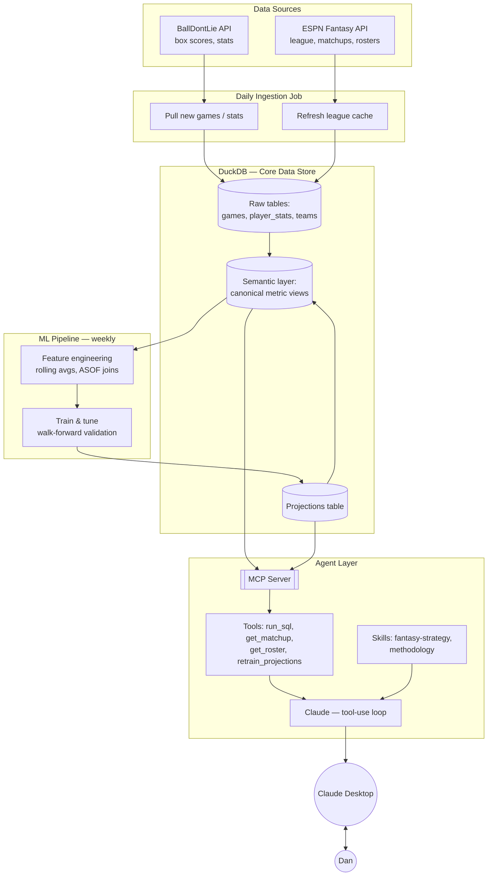

# NBA Analytics + Fantasy Strategy Agent — Design Spec

## 1. Goals

1. A system that pulls NBA data daily, stores it, and can be questioned in plain language via an agentic process.
2. A learning vehicle for how to design and deploy AI agents for analytics — with validity as a first-class concern, not an afterthought.

Four product surfaces: ad hoc stat questions ("40+ pts / 12+ reb as a road player"), career/season-view analytics, weekly fantasy strategy (draft, lineup, waivers) for an ESPN category-based head-to-head league, and open-ended data-science questions answered with a stated, checkable methodology.

---

## 2. Data Sources

### NBA data — BallDontLie API
Replaces the old CSVs and the previous stats.nba.com scraping approach entirely. Keyed, stable, no VPN rotation needed. Covers NBA data back to 1946.

| Endpoint group | Free | ALL-STAR ($9.99/mo) | GOAT ($39.99/mo) |
|---|---|---|---|
| Teams / Players | Yes | Yes | Yes |
| Games | Current season only | Full history | Full history |
| Stats / Season Averages | No | Yes | Yes |
| Advanced Stats / Box Scores / Standings / Leaders / Odds | No | No | Yes |

Rate limits (GOAT verified against the real response header during Phase 1 build): **600 req/min** — not the 6,000/min originally sourced from the docs page, which was wrong. Free (30 req/min) and ALL-STAR (600 req/min) figures still come from the docs page and haven't been independently re-verified the same way — treat as provisional until confirmed against a real header.

**Recommendation:** GOAT tier. Historical backfill isn't season-dependent, so there's no reason to wait for the season to start — the free tier is only useful for prototyping against Teams/Players. Box scores, advanced stats, and standings all require GOAT, and they're used across career-view analytics, the ad hoc query agent, and the methodology agent. ALL-STAR is a viable cheaper starting point if you want to validate the pipeline before committing to the full spend.

### Fantasy league data — ESPN Fantasy API via `espn-api` (Python)
Actively maintained (last verified push April 2026). Reads your league's actual scoring categories, roster rules, current matchup, opponent roster, standings, and free agents. Private-league auth uses two cookie values (`SWID`, `ESPN_S2`) pulled from your browser after logging in — a one-time setup. Risk: unofficial/reverse-engineered, so it's possible (not currently observed) for ESPN to break it; worth a five-minute smoke test against your real league before building on top of it.

---

## 3. Storage — DuckDB

Embedded, columnar, analytical database — no server process, single file on disk, reads/writes Parquet natively. Chosen over Postgres because the workload is almost entirely read-heavy aggregation (season rollups, career splits, "how many times has X happened"), which is exactly what a columnar engine is built for.

Two features that matter specifically for this project:
- **ASOF JOIN** — matches each row to the closest *preceding* row in another table by timestamp, natively. This is how features get built without leaking future information (e.g., "this player's rolling average *as of the day before* this game"). Most analytical databases fake this with slow self-joins; DuckDB has it as a first-class join type.
- **`vss` extension** — adds HNSW-based vector similarity search directly in DuckDB, in case the methodology agent ever needs to search over your own written notes/definitions. Means no separate vector database product is needed even if that use case comes up.

If a hosted/shareable version is ever wanted later, MotherDuck is DuckDB-as-a-service with minimal code changes.

---

## 4. Player Identity & Validation

- BallDontLie already assigns a canonical `player_id` — resolving which rows belong to the same real person is the data provider's job, not something to build. A trade mid-season should already carry one stable `player_id` across all games, with `team_id` changing per game to reflect who they were playing for.
- Because of that, this phase is validation, not construction: spot-check a few known trade/multi-team-season cases to confirm the ID actually holds up in practice before trusting it blindly.
- Cross-source ID reconciliation would become real work only if a second data source is ever added later — not a concern while BallDontLie is the sole source of truth.

---

## 5. Semantic Layer

A single canonical definition — one SQL view per derived metric (true shooting %, category value for the fantasy league, whatever else comes up) — computed once and referenced everywhere, rather than re-derived ad hoc by the agent each time it's asked. Without this, an agent that writes fresh SQL per question is a silent inconsistency risk: the same question asked two ways could produce two different answers with no way to know why. This is the mechanism by which "ensuring validity" actually gets enforced system-wide, not just talked about.

**Verified findings from real data, confirmed during Phase 1 build:**
- Stat tracking has partial onset years, not clean cutoffs — steals were ~29% populated in 1973, ~47% in 1974. `v_stat_first_tracked` exposes a first-full-season column so a query can filter itself correctly instead of assuming a hard cutoff year. Sharper finding on this one: a naive career steals leaderboard's *numbers* come out nearly correct (Stockton 3,264 vs. the real 3,265) — the defect isn't the arithmetic, it's calling it "all-time" at all, which structurally excludes players like Robertson, West, and Chamberlain not because they weren't good at it but because no one was counting yet. A correct answer needs to caveat the claim, not just get the numbers right — and this failure mode is harder to catch precisely because the output looks right.
- 206,090 rows (all pre-1950) have `NULL` rebounds — any query filtering on a rebounds threshold structurally excludes that entire era, not because those players didn't grab boards, but because it was never recorded. Same category of caveat as the steals finding above, and it applies directly to the project's own flagship query ("40+ points, 12+ rebounds as a road player").
- `plus_minus` never reaches full coverage, even in the modern era (peaked ~83% in 2020, ~63% now) — permanently partial, not "modern data is fine." `v_player_season_totals` carries a `games_with_plus_minus` count alongside the sum so a partial total is never mistaken for a complete one.
- `players.team_id` is a live snapshot of a player's *current* team, not their team at the time of a given game — confirmed mismatched on 56% of a 3,000-row sample. Historical team context must always come from the per-game `team_id` on the stats row; this field should never be used for that.
- The regular-season/playoff boundary isn't a hard reset for rolling-window stats — a player's first playoff game still carries late-regular-season games in its rolling average. Documented as intentional behavior, not a bug, unless a future use case needs otherwise.
- The `postseason` API flag is unreliable for identifying play-in games, not just Cup-final games — it reads `false` for play-in in 2022-2025, `true` in 2019 and 2021, and is split within 2020. `ist_stage` offers no help either (`NULL` on every row). Resolved with an independent classification in `semantic.sql`, built on per-team game counts rather than either flag: a Cup final is the season's sole December game on its date where both teams exceed the scheduled slate (season ≥ 2023); play-in games are each team's chronologically last games beyond the scheduled count, requiring both teams in the game to qualify. A `schedule_is_uniform` guard declines to classify play-in games when a season's schedule is irregular — the COVID-paused 2019-20 season saw teams stop at anywhere from 64 to 75 games, versus 2020-21's uniformly shortened 72-game season — rather than inventing false positives. `v_game_classification_audit` checks the result continuously: a uniform season must yield exactly `scheduled × teams / 2` regular games. Verified against three official 2024-25 averages spanning both exclusion cases (SGA and Giannis for Cup-final exclusion, Trae Young for play-in exclusion) — all match exactly post-fix.
- **Open decision, not yet settled:** DNPs currently count as zero in the rolling window — correct for fantasy point totals, likely wrong for reading current form. Must be settled before Phase 6 (projections) consumes these columns.
- Modern-era spot checks alone are insufficient to catch every bug — a deliberately reintroduced defect passed ingestion cleanly and passed all three 2024-25 spot checks, and was only caught by dedicated checks against historical career totals (era-spanning players like Jerry West, Oscar Robertson, Kareem Abdul-Jabbar). Any future validation work needs checks that specifically probe old-era and full-career aggregates, not just recent-season data — bugs can be entirely invisible in the modern slice.

---

## 6. Agent Architecture

**Core mechanism:** Claude + a tool-use loop. Claude is given a system prompt, a set of tool definitions, and a question; it decides whether to call a tool, the tool executes, the result comes back, and Claude decides whether to call another tool or answer. Nothing more exotic than that underlies any "AI agent."

**Harness:** hand-roll a minimal loop first (~150 lines) as a learning exercise, then optionally adopt the **Claude Agent SDK** (built on the same harness that powers Claude Code) once the fundamentals are understood — it removes boilerplate around context management, tool permissions, and MCP extensibility.

**Three distinct question types, handled differently:**
- *Direct/countable* (Phase 4) — "how many times did X happen." One `run_sql` call, one number.
- *Recurring/fixed* (Phase 6) — the same walk-forward-validated model, run weekly.
- *Open-ended/exploratory* (Phase 8) — the agent has to design the analysis itself: define the question precisely, pick a comparison group, control for confounds, check whether the sample is big enough to say anything at all — before running it. This needs real statistics, not just aggregation.

**Tools exposed to the agent:**
- `run_sql(query)` — executes against the read-only snapshot only, never the live file; the workhorse for direct/countable questions. Built and verified with defense in depth: only `SELECT`/`WITH` are permitted, enforced both by a prefix check and independently by DuckDB's own read-only mode (so a bypassed prefix check still can't write); results are capped with a truncation note rather than overwhelming the model; query errors return as text so the model can self-correct instead of crashing. The schema is introspected at runtime rather than hardcoded, so the system prompt can't silently drift from the real database. The system prompt itself documents every landmine found so far, each tied to the concrete case that surfaced it — the postseason/Cup-final discrepancy, the `players.team_id` snapshot mismatch, `plus_minus` incompleteness — plus an instruction to prefer semantic views over ad hoc SQL, with the reason (two answers to one question, no way to adjudicate).
- `run_analysis(code)` — executes Python/stats code (correlation, regression, significance testing) in the same environment as the ML pipeline; the workhorse for open-ended questions, since aggregation alone can't answer "does X correlate with Y"
- `get_matchup(week)` — current H2H matchup from cached ESPN data
- `get_roster()` / `get_free_agents()` — from cached ESPN data
- `retrain_projections()` — triggers the ML pipeline (Section 7), gated by a validation check before promoting a new model version

**Skills** (packaged, model-invoked expertise — `SKILL.md` files Claude loads autonomously when relevant):
- `fantasy-strategy` — the category-league marginal-impact methodology (Section 8)
- `methodology` — the validity checklist for open-ended research questions: commit to sample definition, comparison group, and confounds *before* running the analysis

**Front end — recommended path:** wrap the tools as a local **MCP server** and connect it to **Claude Desktop**, which already supports local MCP servers via config. This makes the "front end" an app you already have installed, and shrinks the actual build to the data layer and tool definitions — no bespoke UI required. A custom web/CLI front end remains an option later if more UI control is wanted.

**Concurrency constraint, discovered during Phase 1:** DuckDB is single-writer and holds an exclusive lock on its file while ingestion is running — an agent can't open the same file for reading at that moment. Resolution: ingestion keeps writing to the live file as before, then copies it to a separate read-only snapshot file once a run completes successfully; the MCP server queries the snapshot exclusively, never the live file. The agent's data is then always exactly as fresh as the last completed ingestion run, never caught mid-write. A naive file copy isn't safe for this — DuckDB keeps a non-empty `.wal` file beside the database during active writes, cleared only by `CHECKPOINT`, so copying just the main file can silently drop committed rows. The snapshot step uses DuckDB's native `COPY FROM DATABASE` instead, staged to a temp file and published via an atomic rename, so a concurrent reader always sees either the complete old snapshot or the complete new one — never a partial one.

Publish gating requires two independent conditions: ingestion completing cleanly, and a permanent `tests/` suite passing. This was proven necessary, not just theoretically nice — a deliberately reintroduced bug passed ingestion cleanly and passed all three 2024-25 spot checks, and was only caught by checks against career-spanning historical totals (Jerry West, Oscar Robertson, Kareem Abdul-Jabbar). During that failure window, the published snapshot kept serving the prior verified data untouched while the live database held the corrupted numbers — readers were fully insulated. One known characteristic: the suite runs after ingestion completes, not as an early-abort, so a bad multi-hour backfill still runs to completion before the gate catches it — correct ordering (data can't be verified before it exists), just not a fast-fail.

---

## 7. ML Projection Pipeline

**Division of labor:** DuckDB builds features; Python (scikit-learn / XGBoost / LightGBM) fits and tunes the model; the LLM agent orchestrates and reasons over the output — it does not do the numerical optimization itself.

**Pipeline:**
1. Feature engineering in DuckDB — rolling averages, per-36 rates, rest days, opponent pace/defensive rating, home/road splits, built with ASOF JOIN for point-in-time correctness.
2. Train + tune in Python, evaluated by **walk-forward validation** (same discipline already used in the quant research tool — player performance is a time series, so random train/test shuffling leaks future information).
3. Projections written back into DuckDB as a normal table: player, week, stat, projected value, model version, generated timestamp.
4. Once games are played, projected-vs-actual gets compared in the same database — a running accuracy record, not just a one-time backtest.

**Building/tuning it with agent help (Claude Code):** give it a falsifiable hypothesis (not "build a good model" — something like "recent-form-weighted average + opponent pace beats a flat season average for rebounds"), the data location, and the fixed evaluation method. It writes code, runs it, reads the validation score, adjusts, and repeats — genuinely agentic model-building, bounded by a number rather than a vibe. Two hard rules: never let it tune against the same data it's judged on (hold out a real final test set), and review before anything gets promoted to production.

**Output as ranges, not points:** low-count stats (blocks, steals, threes) are high-variance — a category-league roster decision should weigh variance, not just expected value.

---

## 8. Fantasy Strategy Logic (category H2H)

For each scored category: compare your roster's recent production to your current opponent's, weighted by each side's remaining games that week (from the NBA schedule). This surfaces which categories are winnable, which are lost causes, and which a specific waiver pickup would flip — a well-defined, agent-executable calculation once projections and matchup data both exist.

---

## 9. System Data Flow

**How it runs:** ingestion runs daily (new games/box scores, refreshed league cache). The ML pipeline runs weekly, ahead of matchup deadlines. The agent runs on demand — a question in Claude Desktop triggers the MCP server's tools against the current state of DuckDB.

---

## 10. Build Order

1. **Pipeline + schema** — daily ingestion, historical backfill — complete: 1,685,039 rows across 73,174 games, 5,147 players, 80 seasons (1946-2025), verified intact after an unplanned power loss
2. **Player identity validation** — spot-check that BallDontLie's `player_id` already resolves correctly across trades/multi-team seasons (it should, as the data provider's job) — light verification, not a build
3. **Semantic layer** — canonical metric definitions
4. **Text-to-SQL Q&A agent** — ad hoc stat questions; validates the schema end to end
5. **Fantasy league integration** — `espn-api` caching of league settings, matchups, rosters, free agents
6. **Projection pipeline** — feature engineering, walk-forward-validated model, projections stored in DuckDB
7. **Fantasy strategy agent** — category marginal-impact logic using projections + matchups
8. **Data science methodology agent** — open-ended questions, validity checklist enforced up front, backed by the `run_analysis` tool for real statistics (correlation, regression, significance testing) rather than aggregation alone

---

## 11. Costs & Practical Notes

- **BallDontLie:** GOAT tier, $39.99/mo (or ALL-STAR at $9.99/mo to start cheaper).
- **Claude API:** billed separately from a claude.ai subscription — requires separate Console setup. Roughly: Haiku ~$1/$5 per million input/output tokens, Sonnet ~$3/$15. For this usage pattern (a handful of daily questions, one weekly strategy session), likely a few dollars a month, routing routine text-to-SQL steps to Haiku and reserving Sonnet for harder reasoning keeps it cheap. A hard spend cap can be set in the Console.
- **ESPN auth:** one-time SWID/ESPN_S2 cookie extraction; verify against the real league before building on it.

---

## 12. Open Questions

- Exact model family for projections (start simple — rolling averages / gradient-boosted trees — before anything fancier)
- Whether a custom UI is ever wanted beyond Claude Desktop
- Specific confound list for the methodology agent's validity checklist (garbage time, opponent strength, rest days, etc.) — worth drafting once Phase 8 is reached

---

## 13. Showcase / Demo Artifact

A separate, deliberately lightweight piece from the main system — built to be shown off (e.g., to a boss), not to run the actual daily pipeline. Runs as a published Claude artifact: no separate hosting account, no server to manage, shareable via a single link.

**What it shows:**
- Trend visuals — rolling-window/season charts for a few notable metrics
- A correlation view — pick two variables, see the relationship plotted
- Highlight stats — a few "wow" facts computed by the real pipeline (e.g., the 40+/12+ road-game count), to demonstrate the kind of question the full system answers
- A live "ask it something" box — a genuine natural-language Q&A field, answered by Claude in real time inside the page, grounded in the embedded data. Not a canned script — it actually answers a new question live, which is the most convincing thing to show someone.

**How data gets there:** the showcase has no route back to the local DuckDB — a published page can't reach into a home machine. Instead, data lives in the artifact's own shared store, refreshed periodically by asking Claude (in a chat like this) to pull a current snapshot from the real pipeline and update it. "Refresh the showcase" becomes a one-line request whenever it needs to be current — before a specific meeting, or on whatever cadence is wanted. The real system stays exactly as speced elsewhere in this document; the showcase is a curated, occasionally-refreshed reflection of it, not a second live copy.

**Built from:**
- One self-contained published HTML page
- A shared data store holding the current snapshot (trend data, correlation datasets, highlight stats) as JSON
- A live-query capability powering the Q&A box, using the stored snapshot as its grounding context

**Deliberately excluded:**
- No live connection to the local system, ESPN league, or daily ingestion — that's what keeps it free and simple
- No write access for viewers — a look-and-ask demo, not an editable tool
- Not a substitute for the real system — a display case for it

**Refresh cadence:** on demand, ideally right before it's actually shown to someone — staleness is the only real risk with a snapshot-based approach.
